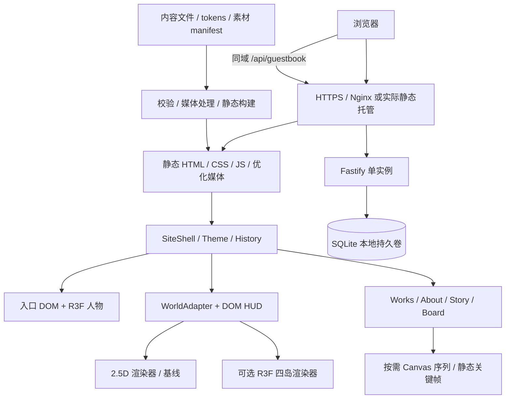

> 最新交付（2026-10-13）：第一版最后调整已完成并部署，P2 ready_for_review，本机与公网验收通过。CONNECT呼吸闪烁；About真3D人物鼠标跟随；HELLO STRANGER禁用跟随，后续换伸手视频。背景本轮仅分析，补素材后的下一版才改进。以[P2当前交接](../agent-work/phases/P2/handoff.md)、[P2-09报告](../agent-work/reports/P2-09.md)、[下一版素材方案](../agent-work/background-next-version.md)为准。此前六项菱形/触摸/主题作品保留，P3–P5未启动。


# 完整实施方案：架构、选型与接口

下列目录、类型和命令是后续拟建规范，不表示已有生产实现。ChatGPT 负责落实与锁定，Grok 按已冻结的接口完成一般模块。

部署事实更新：用户已指定 `ubuntu@124.220.190.120` 的Ubuntu24.04服务器，并要求运行在Docker中。具体编程、Linux生产镜像验证、Git/镜像交付和Compose流程以 [06-development-deployment.md](06-development-deployment.md) 为准；域名/证书与镜像仓库仍待落实。

实施按 [五阶段计划](07-phased-plan.md) 分步进行：阶段1建可继续复用的draft骨架与基本容器；阶段2修正和冻结第一版接口；阶段3完善正式素材；阶段4落实下文完整生产能力和所授权部署；阶段5补丁修正。此文是最终技术目标，不要求阶段1一次完成全部生产功能。

## 架构

采用 **Next.js App Router + React + TypeScript 静态内容站**；入口人物使用 **Three.js / React Three Fiber（R3F）/ GLB**；Hub 通过统一 WorldAdapter 支持 2.5D 基线与可选完整 3D；动效用 GSAP；独立 Fastify + SQLite 服务处理公开留言。CSS Modules 配合现有 tokens，不引入第二套视觉系统。



路由、正文与表单始终是 DOM。WebGL 是人物和可选世界的增强层，不承担文字排版或网站能否访问的唯一入口。

## 技术选型

| 层 | 选择 | 实施约束 |
|---|---|---|
| 前端 | Next.js 稳定版、React、TypeScript | `output: 'export'`、`trailingSlash: true`；版本开始实施时按官方兼容范围锁定 |
| 包管理 | pnpm workspace + lockfile | 根应用 + `services/guestbook`；ChatGPT 独占依赖与 lockfile 修改，Node LTS 版本写入环境说明 |
| 样式 | CSS Modules、CSS variables、现有 tokens generator | tokens 扩展 day/night/paper；生成器保持可重放 |
| 人物 3D | Three.js、R3F、必要的 Drei 工具、glTF loader | 懒加载客户端组件，构建阶段不触碰 window/GPU；先确保代理模型通路 |
| Hub | 2.5D 图层/DOM + 统一旅行控制器 | 这是未决定完整 3D 时的建议基线，不改变四岛设计 |
| 可选 Hub 3D | R3F + 同一世界状态契约 | 经用户选择后制作模型与 3D adapter；不并行维护两套导航状态 |
| 转场 | GSAP timeline / ScrollTrigger | 路由揭幕、开场和 Story；运动对象只有一个写入者 |
| 内容 | 类型校验 JSON；长说明可选本地 MDX | 优先用现有数据需求，MDX 只接受仓库可信作者，不执行游客输入 |
| 媒体 | Sharp 构建前生成 picture/srcset | AVIF/WebP + PNG/JPEG 回退，明确宽高、裁切与 loading |
| API | Fastify + JSON schema + 限流插件 | 输入校验、幂等、审核隔离、真实错误状态由 ChatGPT 实现 |
| 数据库 | SQLite + `better-sqlite3` 候选驱动 | 实施时核实 Node/native module 兼容性；容器内安装，WAL/backup 用安全 API |
| 测试 | Vitest + Playwright | 测控制算法、关键流程与服务，不为纯样式组件堆实现镜像测试 |
| 运行 | Nginx / HTTPS、Docker Compose | 用户已要求Docker，目标Ubuntu服务器已定；先提供同一Linux生产镜像的本机验证和可复现配置 |

静态导出不能承载动态 POST 服务、Server Actions 或默认服务端图像优化；作品 `[slug]` 在构建时枚举。留言独立运行，图片预处理。[Next.js 官方静态导出文档](https://nextjs.org/docs/app/guides/static-exports)

## 目录与核心责任

```text
SYYhSite/
  app/                         # ChatGPT：layout、page 路由、metadata、404
    hub/ works/ works/[slug]/ about/ story/ board/
  src/
    components/ui/             # Grok：已定规范的 Button/Frame/EmptyState 等
    components/layout/         # ChatGPT：常驻 HUD、导航、错误边界
    features/gate/avatar/      # ChatGPT：人物与骨骼控制
    features/world/            # ChatGPT：旅行、聚焦、WorldAdapter、2.5D
    features/world3d/          # ChatGPT：可选 3D renderer
    features/works/            # Grok：列表、详情展示
    features/about/            # Grok：资料与时间线展示
    features/story/            # ChatGPT：缓存/播放器；Grok：静态章节排版
    features/board/            # ChatGPT：提交/API；Grok：纯展示列表、联系条目
    state/ lib/contracts/      # ChatGPT：主题、session、schema、公共契约
    content/                   # Grok：真实资料规范化；ChatGPT：schema
  public/media/                # 仅经校验的优化成品与运行时 manifest
  assets/source/               # ChatGPT：原图、.blend、脚本、源贴图，按 v001 版本
  assets/research/             # Grok：来源/许可与候选，不自动发布
  scripts/                    # 媒体/验证脚本；token 脚本由 ChatGPT 管
  services/guestbook/          # ChatGPT：服务、迁移、审核 CLI
  deploy/                     # ChatGPT：运行、备份、恢复与配置
  tests/                      # 按任务归属编写，ChatGPT 运行集成验收
  docs/agent-handoff/          # 本包与协作状态
  docs/agent-work/             # 后续任务输入、研究、交接与证据
  design/ prototype/          # 历史设计资产原位保留
```

原 UMD bundle 与 `window.SYYH` 仅为设计参考，逐模块迁移，不以 CDN React 原型作为正式网站。

## 路由、状态与数据契约

| URL | 规则 |
|---|---|
| `/` | 可跳过 Intro + Visitor Access；会话昵称可空 |
| `/hub/` | 总览或恢复快照，语义化频道列表始终可访问 |
| `/works/`、`/works/[slug]/` | 静态列表与详情，刷新、分享、返回均有效 |
| `/about/` | 同一页面的局部 Paper 阅读态 |
| `/story/` | 原生滚动，关键帧阅读基础版与可选序列增强 |
| `/board/` | 联系方式与留言；API 不可用时清楚显示状态 |

URL 决定当前页面；禁止仅用 `screen` state 冒充导航。layout 保存低频会话状态，ref/controller 保存逐帧状态。localStorage 只保存主题、轻量等偏好，读取失败安全回退；sessionStorage 保存昵称、入口已播放与 Hub 快照，版本化校验，坏数据不影响进入。人物资源不因 direct deep link 强制下载。

建议共享类型如下，ChatGPT在P1-02建立初版、P2-04按修正后的范围冻结具体实现：

```ts
type Theme = 'day' | 'night';
type ChannelId = 'works' | 'about' | 'story' | 'board';
type IslandId = 'sky' | 'ancient' | 'apocalypse' | 'anime-home';
type WorldPhase = 'exploring' | 'focused' | 'entering' | 'content' | 'returning';
type WorldSnapshot =
  | { version: 1; mode: 'flat'; center: [number, number]; zoom: number; focusedId: IslandId | null }
  | { version: 1; mode: 'three'; position: [number, number, number]; target: [number, number, number]; focusedId: IslandId | null };
interface WorldAdapter {
  setTheme(theme: Theme): void;
  setPaused(paused: boolean): void;
  restore(snapshot: WorldSnapshot): boolean;
  snapshot(): WorldSnapshot;
  focus(): IslandId | null;
  enter(id: IslandId, signal: AbortSignal): Promise<void>;
  dispose(): void;
}
```

快照不跨渲染模式直接解释；模式不匹配回总览。`enter` 只处理视觉过渡，NavigationController 负责唯一 router 跳转。频道绑定空值时开发显示未绑定，发布时四频道必须有可用语义入口。

内容最低契约：Work 包含 `slug/title/summary/year/media/role/body/status`；Media 包含 `src/width/height/alt/credit/assetId`；Profile 包含真实 `name/bio/interests/timeline/links`；Story 包含章名、正文、poster、可选 frames；Link 只允许已验证 https/mailto 等协议。内容 schema 与样例由 lead 先交付，Grok 才编页面。`status: draft` 内容不导出公开列表和 sitemap。

## 人物核心实现

`AvatarCanvas` 透明背景、固定相机；`AvatarAsset` 负责加载、骨架实例与海报；`AvatarController` 唯一写最终骨骼；`AvatarLighting` 依据 Theme 设置两套光照。

入口 pointermove → 相对容器归一化 → 限幅目标 → 按时间阻尼 → 基础待机姿态叠加头/眼/上身偏移。先 update AnimationMixer，再基于当帧基础姿态求最终四元数，不累积旋转，不让 mixer 与跟随分别覆盖骨骼。GLB 的真实骨骼轴、正前方和 bind pose 由 config 映射，不按名称猜模型轴向。

眨眼只占对应 morph/眼睑，待机 clip 不覆盖跟随使用的最终结果。单一 `useFrame` 驱动，不每帧 setState。离开区域、窗口失焦、减少动态、模型失败与卸载均有明确处理。人物灯光可调，但材质、发型和身份不随主题变更。

先用本机 Blender 制作可回读代理人形验证眼/头动作，待角色设计确定再替换正式 GLB；代理阶段合格不等于正式美术完成。

## Hub 控制与进入

Pointer/Wheel/Touch/Keyboard 共用 InputController，统一给 CameraController 目标值；视角更新有 clamp、dt 上限及暂停恢复。2.5D 以世界坐标平移/缩放图层；3D 以观察目标 + 固定斜上偏移求相机。全 3D 的 docking view、入口轨迹、模型碰撞体在白盒阶段校准，二维像素半径不能直接套到米制模型。

FOCUSED 由停靠距离、进出阈值和稳定时间决定，不由一次 hover/raycast 决定。点击再验证 focusedId、拖动距离、asset ready 和输入锁。进入中 GSAP 只驱动过渡参数，由唯一控制器写 transform/camera。完成、异常、Abort 或卸载时均释放锁。

所有频道有正常链接；无 JS 可浏览静态内容，Hub 本身以目录降级。返回、刷新、旋屏与 renderer 模式变化均校验快照。路由离开暂停场景；人物和 Hub 不同时持续运行两套高负载 renderer。

## Story 两阶段

先做 3–6 张关键帧 + 三章完整正文；后做获选故事的滚动序列。首屏和 Hub 不预载序列。桌面 120–180 帧/1280×720、手机 60–90 帧/640×360 是候选预算，制作前用一个短章验证压缩与解码成本。

Canvas 的 DPR 与尺寸分别设限；帧索引 clamp，上一成功帧兜底。帧缓存 desktop 约 16 张720p、mobile 约12张360p；720p RGBA 单张约3.5MiB，不能全量解码。使用 LRU、有界并发解码、及时关闭淘汰的 ImageBitmap、取消过期请求；章节切换和卸载释放缓存。用户减少动态/轻量、素材缺失或 Save-Data 提示时显示静态正文。ScrollTrigger 卸载清理，不引入第二套全局平滑滚动器。

## 留言接口与服务

- `GET /api/guestbook?cursor=...&limit=20`：只返回 approved，稳定 created_at/id 排序，返回 `items,nextCursor`；limit 上限50。
- `POST /api/guestbook`：`{callsign,message,submissionId,website?}`；空昵称转 GUEST，昵称1–24 Unicode码点，消息1–140码点，trim 后验证；website 是隐藏 honeypot，不作真实资料。
- 新提交返回202 `{id,status:'pending'}`；同 submissionId + 同请求返回原结果，不重复插入；同 ID 不同内容返回409。413/422/429/5xx 提供可读提示，失败保留表单，429 包含 Retry-After。

表字段：`id, submission_id UNIQUE, callsign, message, status, created_at, reviewed_at`；status 为 pending/approved/rejected。参数化 SQL，纯文本 DOM 渲染，无 HTML/MDX。禁止 public GET 泄露 pending 或审核字段中的内部资料。

同域接口、允许来源校验、合理 body 上限与速率限制；反向代理可信 IP 配置明确，不能信任任意客户端 X-Forwarded-For。速率计数只作必要使用，敏感请求信息不进公开日志。服务端审核 CLI/list/approve/reject 为首版管理方式，管理员权限不放入前端。迁移可重复且启动检查，生产数据不随 deploy 覆盖。

SQLite 单实例、同机本地持久盘；容器重启持久化。备份使用驱动 backup 或 SQLite 在线备份能力，恢复到独立目录校验 approved/pending 数据；不得仅复制运行中 WAL 数据库的主文件。多实例需求出现后另选 PostgreSQL，不提前引入 Redis。具体 SQLite 版本及已知修复在实施开始时核对。[SQLite WAL 官方说明](https://www.sqlite.org/wal.html)

## 资源与性能目标

| 对象 | 初始预算 / 策略（均待实测） |
|---|---|
| DOM 首屏 | 优先标题/控件与250KB量级主海报；不要为等待 GLB 挡住游客按钮 |
| 人物 | GLB 含贴图候选≤4MB，约30k–60k triangles；从代理实测再调；桌面 DPR≤1.5，手机≤1–1.25 |
| 2.5D Hub | 四岛图按视距/设备加载，一张图不为全站重复下载；大面积透明叠层与模糊受控 |
| 可选3D Hub | 全场景可见约150k–250k triangles、draw calls≤100；单岛GLB含贴图1–3MB候选，优先低LOD |
| Story | 当前章窗口缓存，不全量预载/解码 |
| 内容页 | 目标移动 LCP≤2.5s、INP≤200ms、CLS≤0.1；真实设备采样验证 |
| 渲染 | 常见桌面目标60fps，目标手机至少稳定30fps；记录设备/分辨率/耗时，失败即降低质量或用静态模式 |

压缩传输大小与显存分别计量；1024² RGBA纹理约4MiB，mipmap另加约1/3；加载失败、context lost、隐藏标签页都可回退和恢复。共享 geometry/material 缓存需明确所有权，不在一个实例卸载时误 dispose 其他实例资源。

浮动/待机开启时需要连续帧；完全静态时才使用按需绘制。实例化、LOD 与资源复用遵循 [R3F 性能文档](https://r3f.docs.pmnd.rs/advanced/scaling-performance)。预算为本项目建议，不是库保证或已经测出的成绩。

## 构建与部署交付

实施后统一提供 scripts：`dev / build / typecheck / lint / test / test:e2e / media:build / assets:verify` 与 guestbook 独立命令。当前 package.json 只有 tokens/draft，后续 agent 不把上述拟建命令写成已经可用。

pnpm install 使用锁定依赖；静态导出路由与媒体校验通过后产生 out/。Nginx 正确匹配 trailing-slash HTML、返回404，`/api/` 保留路径转发 Fastify；HTTPS、压缩、hash媒体长缓存与HTML短缓存按实际托管配置。Compose 挂载本地数据库卷，提供健康检查、优雅关闭、迁移、备份/恢复命令、env.example（无真实密钥）。

浏览器 CSP 允许必要的自托管资源与主题初始化方式；不靠无限放开策略解决。API 开发代理与实际生产同域路径一致。目标服务器已定，当前先交付本地可审查结果和对应Docker方案；域名/TLS与实际公开发布按用户后续指令落实。
