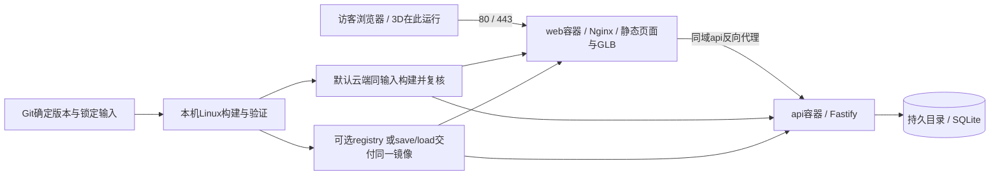

> 执行更新（2026-10-12）：用户已启动阶段1，并明确授权本机开发、GitHub交付与云端Docker部署。本文中的“本轮未开始/云端默认阶段4”为原规划时状态；当前范围以 [阶段1执行交接](../agent-work/phases/P1/handoff.md) 和 phases/tasks.json 为准。阶段2–5尚未启动。

# 本机编程、Docker 验证与 Ubuntu 部署流程

更新：2026-10-12。此方案补充已有完整交接包；**本轮仅梳理流程与只读复核，未安装Docker、推送代码、构建镜像或部署网站。** 用户明确要求网站运行在Docker中，目标服务器已经确定，覆盖旧方案中“托管环境未定”的部分。

本正文已合并进 [complete-plan.md](complete-plan.md)。阶段对应以 [07-phased-plan.md](07-phased-plan.md) 为准：P1基本本机Docker，P2修正/冻结输入，P3资源优化，P4完整生产验证与所授权Ubuntu部署，P5补丁发布/回归。

## 结论

用户提出的“本机开发 → 本机Docker验证 → Git上传 → Ubuntu拉代码构建并运行”可行。需要调整顺序为：**拉取确定版本代码 → Dockerfile内安装依赖和构建镜像 → Compose启动镜像**。依赖在镜像构建时安装，宿主Ubuntu无需再安装Node/pnpm或应用node_modules。

2 vCPU/约3.6GiB内存不等于不能构建本项目；应实测构建峰值内存和耗时。此前对Docker Hub原站的curl超时，也不能推导Docker通过腾讯镜像源拉常用镜像会失败。原站直连、Docker镜像源拉取、应用私有registry是不同访问路径。[Docker镜像源说明](https://docs.docker.com/docker-hub/image-library/mirror/)

当前优先沿用用户原设想：**本机开发 → 固定版本 → 本机Linux容器构建/验证 → Git上传 → Ubuntu获取同一版本 → 按同一Dockerfile与锁定输入构建 → Compose启动 → 云端复核。**

若云端构建实测过慢、影响运行服务或内存不足，再选本机/CI构建+可达镜像仓库push/pull；`docker save → scp → docker load`作为离线/应急备选，不默认每次传全量镜像包。最终选择比较实际传输大小/带宽、冷/热缓存构建时间与峰值内存，不只看机器配置。Dockerfile、Compose服务结构与应用接口保持一致。

## 已验证事实

服务器来源：已读取Codex任务“整理服务器信息与登录指南”，并读 [server.md](D:/dev/yyh_server/server.md)。2026-10-12 14:44（Asia/Shanghai）再次通过SSH只读复核系统、内存、磁盘、Docker、容器与监听端口。

| 项目 | 事实 / 证据范围 | 对流程的影响 |
|---|---|---|
| 云端目标 | `ubuntu@124.220.190.120`，Ubuntu24.04.4 LTS，x86_64 | 统一镜像平台 `linux/amd64` |
| 云端资源 | 2 vCPU（原审计）；约3.6GiB内存，复核时可用约3.1GiB；60GiB盘，剩余约51G | 运行与构建均需实测；规格本身不构成云端构建不可行的证据 |
| Docker | Engine29.6.1、Compose v5.3.1，实际命令返回 | 不需要为本项目重新安装云端Docker |
| 权限 | ubuntu免密sudo；Docker操作按原审计使用 `sudo -n docker ...` | 部署脚本统一使用此方式，不以root SSH或改docker组为前提 |
| 当前服务 | 复核无容器，80/443无监听 | 可规划web端口；部署时仍重新确认，不保证云安全组已放行 |
| 云端网络 | 2026-10-11审计：Docker Hub直连5s超时，腾讯镜像源HTTP200 | 不据原站直连测试否定镜像源拉取；开始时验证选定Node/Nginx具体tag，Git/npm另测 |
| 本机 | Windows11专业版x64、Intel Ultra5 125H、约32GBRAM | 可使用WSL2 Linux容器开发/构建 |
| WSL | 实测Ubuntu发行版为WSL2，当前Stopped | 已有Linux后端基础，不等于Docker引擎已运行 |
| 本机Docker | PATH及系统/用户常见Docker Desktop位置未找到可执行文件 | 先核实是否其他安装位置或WSL内引擎；当前尚不能宣称本机Docker验证可执行 |
| 仓库 | `https://github.com/smallyyh0721/SYYhSite.git`，当前只有设计原型与方案 | 先实施正式工程；Git远程存在不代表服务器拉取权限/网络已验收 |

机器可读摘要见 [deployment-facts.json](deployment-facts.json)。本轮未重新测试镜像源、Git/npm公网连通或云控制台规则，因此这些仍为部署前检查项。

## Windows与Ubuntu的一致性怎样保证

本机Docker必须运行**Linux containers**，使用Docker Desktop的WSL2后端或明确配置的WSL内Linux Docker。不是用Windows容器在本机测试后拿去Ubuntu运行。[Docker WSL2官方说明](https://docs.docker.com/desktop/features/wsl/)

镜像统一 `linux/amd64`，固定Node/pnpm版本、依赖锁文件、基础镜像digest、构建参数与运行入口。容器基础发行版无需恰好是Ubuntu24.04；应用依赖属于镜像内部。容器仍依赖宿主内核与运行环境，网络、权限、挂载、磁盘、端口和浏览器实际表现必须在云端复核。[Docker平台说明](https://docs.docker.com/build/building/multi-platform/)

同一已测镜像直接上线提供最强的产物一致性；服务器从固定源码重新构建也是有效方案。两种方案都要求明确Git/媒体版本、Dockerfile、基础image digest、锁文件和构建参数；服务器重建后补做运行验收。开发态热更新容器与生产验证分开；生产验证禁止挂本机源码或Windows node_modules，否则测到的可能不是镜像内文件。

| 常见差异 | 本项目处理 |
|---|---|
| Windows依赖包含平台二进制 | `.dockerignore`排除node_modules/.next/out；Linux镜像内 `pnpm install --frozen-lockfile`，Sharp/SQLite驱动在Linux安装 |
| glibc/musl | Node构建与API运行阶段先选择同一Debian slim族基础镜像，减少原生模块差异；不为省几MB直接混用Alpine运行API |
| CRLF/BOM | shell脚本LF、无BOM；实施时加 `.gitattributes`；Python/PS脚本按实际解释器运行 |
| 大小写路径 | Docker Linux构建验证import和媒体路径；必要时在WSL Linux文件系统checkout验证大小写问题 |
| bind mount/UID | 开发可挂源码；生产代码/静态资源只进镜像，持久数据挂独立目录并匹配API运行UID |
| `localhost` | 容器间以Compose服务名 `api` 等通信；前端请求同源 `/api/`，不把容器localhost当API宿主 |
| 本机速度/显卡 | 3D与Canvas运行在访客浏览器，云服务器不负责实时渲染模型，也不需装Blender/GPU |

## 编程流程

1. **准备工具：** 核实本机Docker安装路径/WSL内引擎；如需安装，按用户后续启动范围执行Docker Desktop设置。确认 `docker version` 的Server为Linux、Compose/Buildx可用，实际跑最小容器。此轮不执行安装。
2. **建立正式工程：** ChatGPT完成Next静态导出、TS、pnpm lock、公共契约、两主题、Dockerfile/Compose。只安装项目需要的依赖；不把原型CDN bundle直接投入生产。
3. **日常开发：** 页面可在Windows Node或WSL快速热更新；API与SQLite优先Linux容器验证。Grok只改自己分配的一般展示模块；ChatGPT维护依赖/容器配置与核心代码。日常速度优化不能替代生产镜像测试。
4. **素材生产：** 图片与Blender在本机做，发布所需优化媒体和runtime manifest进入构建输入；`.blend`、母版和无关素材库不进入运行镜像。中间媒体需要可复现归档，不只存在个人临时目录。
5. **质量检查：** 类型/关键测试/内容与素材校验；构建全部静态路由、API与健康检查；本机按正式Compose用生产镜像跑全流程。
6. **固定发布输入：** 选择已提交的代码与媒体版本、锁文件和构建参数；release记录Git SHA、独立release ID、镜像ID或registry digest、平台、配置版本与验证结果。相同Git SHA配不同构建参数时不能覆盖旧镜像tag。
7. **交付发布输入：** 默认由Git交付确定源码/配置/媒体版本，服务器按冻结输入构建；选择镜像路线时交付已验证镜像和校验记录。两种方式都包括production Compose、非秘密配置和release manifest，不让服务器随意取移动中的branch HEAD。

如果D盘bind mount在大量文件监听时变慢，可将开发checkout放到WSL的Linux文件系统，通过Windows编辑器访问；lead明确唯一工作目录，先保存现有dirty工作再迁移，不并行维护两份未同步的“主源码”。不用为本项目提前移动现有目录。

## 容器部署结构



推荐两个常驻服务：

- **web：** Nginx提供Next的 `out/`、图片、GLB、字体，反代 `/api/`；不运行Next dev server。正式Dockerfile采用Node builder生成静态产物，final只保留Nginx和运行资源。
- **api：** Fastify+Node+Linux依赖+迁移/审核/备份工具；SQLite作为本地文件，无需增加独立数据库容器。默认只在Compose内部网络暴露API端口。

构建阶段安装完整编译依赖，final API仅包含运行依赖；`better-sqlite3`构建与运行使用一致架构、Node ABI和libc。构建工具不留在final镜像。多阶段构建用于分离构建环境和运行产物。[Docker多阶段构建文档](https://docs.docker.com/build/building/multi-stage/)

Day/Night、GLB、Story都属于静态媒体与浏览器代码。当前静态导出架构无需云端运行Blender、imagegen、Grok或图像预处理。若未来引入服务端渲染，再单独调整web镜像，不因“用了Next”就默认生产运行Node前端进程。

### Compose文件划分（后续拟建）

| 文件 | 用途 |
|---|---|
| `deploy/Dockerfile` | 多阶段构建，`web` / `api`目标；安装依赖只发生于构建阶段 |
| `deploy/compose.production.yaml` | 只指定确定image，不含build/source bind mount；内部网络、健康检查、restart、日志轮转、持久数据 |
| `deploy/compose.local.yaml` | 覆盖本机web端口（如127.0.0.1:8080），使用独立测试数据卷；仍运行同一生产镜像 |
| `deploy/compose.build.yaml` | build context/target配置，用于本机或服务器构建，不默认用于生产运行 |
| `deploy/compose.dev.yaml` | 可选热更新/源码挂载，独立dev项目，不作为发布验收对象 |
| `deploy/.env.example` | 非秘密配置名与用途；真实env只在本机/服务器受控位置 |
| `deploy/release-manifest.json` | 每次生成，记录代码/镜像/配置/素材版本与校验结果 |

不在整个主Compose默认配置中绑定80，再试图用override改8080而残留两组port。具体Compose编写时验证merge结果；本机与云端的相同点是镜像、服务与接口，不是相同公网端口或数据路径。

## 三种交付路线比较

| 路线 | 过程 | 优点 | 成本与适用 |
|---|---|---|---|
| A 服务器从源码构建 | Git推送→云端取确定commit→镜像内装依赖/构建→启动 | 不必从本机传完整基础/依赖镜像层；已有缓存可复用 | 当前优先，需测选定镜像拉取、Git/npm、构建峰值内存/耗时，并复核云端产物 |
| B 本机镜像离线交付 | 本机构建/测试→Git存档→save/scp/load→启动 | 云端无需访问镜像库/npm做此次发布；上线镜像与本机验证一致 | 全量archive传输/压缩/导入需计时，作为离线或应急备选 |
| C CI+镜像仓库 | Git→Linux CI测试/构建→registry→云端pull确定digest→启动 | 自动化、可追溯、不占云端构建资源 | 先验收双方网络、认证和registry权限；本机应测试CI产物或明确分层证据。建议稳定后采用 |

腾讯Docker镜像源可用于Docker Hub镜像的镜像/缓存访问；原站直连超时不等于常用镜像无法拉取。它与发布本项目自建image的GHCR/腾讯TCR等registry作用不同，不能用基础镜像加速器自动存储/交付自己的私有image。具体tag、Git/npm与自建image仓库分别验证。路线B全部image已传入时可不依赖云端镜像拉取；公网访问、DNS/TLS仍需复核。

## 镜像传输时间与带宽比较

当前没有本项目生产镜像，也没有测量本机到服务器的有效上传吞吐，**不能给出真实传完时间**。应以实际传送的 `.tar` / 压缩包字节数估算，不能拿 `docker image ls` 的展开体积当传输大小。registry push的实际数据有压缩，进度显示的大小也不一定等于线路上传字节。[Docker push说明](https://docs.docker.com/reference/cli/docker/image/push/)

计算式：`传输秒数 ≈ 实际文件MB × 8 ÷ 稳定有效Mbps`，MB/GB在此采用十进制，1GB=1000MB。以下是场景计算，不是本机测速或实际image大小：

| 稳定有效上传吞吐 | 500MB发布包 | 1GB发布包 |
|---|---|---|
| 10Mbps | 6分40秒 | 13分20秒 |
| 20Mbps | 3分20秒 | 6分40秒 |
| 50Mbps | 1分20秒 | 2分40秒 |
| 100Mbps | 40秒 | 1分20秒 |

这是只传文件的时间，完整发布另加导出/压缩、校验和load时间。家用宽带下载速率不能代替上行吞吐；具体路径还受云端接收能力、路由、SSH/磁盘等影响。如果采用标称链路速率而非实测有效吞吐，应另外计入传输开销。

三种方式的成本不同：

- `save/scp/load`默认每次传完整选定镜像archive，不自动因服务器已有基础层而减少scp字节；压缩收益按实际包测量。[Docker save文档](https://docs.docker.com/reference/cli/docker/image/save/)
- registry利用已存在的相同digest镜像层，后续push/pull通常只传缺失层；Dockerfile将依赖/应用/大媒体合理分层后，可减少纯代码更新传输。媒体若与代码同层，则代码更新仍可能重传整层，缓存不保证“小更新必然小传输”。[Registry API](https://distribution.github.io/distribution/spec/api/)
- Git+服务器构建主要传新增源码/媒体，云端下载缺失base/依赖并编译；已有构建层/包缓存可复用。大GLB和Story图帧仍要传，不保证Git方案天然很小。[Docker构建缓存](https://docs.docker.com/build/cache/optimize/)

后续准备就绪时测一次代表性的发布：记录包大小、scp有效吞吐、冷/热镜像拉取、Git/媒体增量、冷/热构建时间及峰值内存。传输测速用明确的测试文件，记录大小和耗时；本轮没有上传文件或执行镜像pull/build。依据这些值比较“云端构建总耗时”与“本机/CI构建+传输总耗时”，再调整默认路线。

## 可选同一镜像交付流程与命令模板

以下命令为正式工程和deploy文件建立后的模板，**当前尚不可直接完成部署**。本轮没有创建示例中Dockerfile/Compose或运行镜像。release ID和路径使用实际值，不保留示例占位。

### 本机：构建并验证

发布前代码与运行媒体已提交，工作树为预期状态；依赖、base digest和参数已固定。多阶段Dockerfile约定target为web/api后，可在项目根运行：

```powershell
$taskCommit = (git rev-parse HEAD).Trim()
$taskReleaseId = "$taskCommit-r001"
docker buildx build --platform linux/amd64 --load --target web -t "syyh-web:$taskReleaseId" --build-arg "VCS_REF=$taskCommit" -f deploy/Dockerfile .
docker buildx build --platform linux/amd64 --load --target api -t "syyh-api:$taskReleaseId" --build-arg "VCS_REF=$taskCommit" -f deploy/Dockerfile .
```

任一构建失败立即停在该阶段；不可继续上传旧tag冒充新版本。`deploy/.env.local-release`由lead写入当前image tag、测试数据卷和本机端口配置，不含生产秘密。

```powershell
docker compose --env-file deploy/.env.local-release -p syyh-local -f deploy/compose.production.yaml -f deploy/compose.local.yaml config --quiet
docker compose --env-file deploy/.env.local-release -p syyh-local -f deploy/compose.production.yaml -f deploy/compose.local.yaml up -d --no-build --pull never --wait --wait-timeout 120
docker compose --env-file deploy/.env.local-release -p syyh-local -f deploy/compose.production.yaml -f deploy/compose.local.yaml ps
```

生产与本机数据volume/path必须隔离；web可测试127.0.0.1:8080。`--wait`结合已实现healthcheck等待启动，但不替代浏览器流程、留言提交/审核、重启持久化、主题/人物/深链与错误场景。[Compose up官方选项](https://docs.docker.com/reference/cli/docker/compose/up/)

验收通过才记录镜像ID/平台/Git label，导出**全部运行镜像**。若额外TLS/迁移/备份辅助容器依赖其他image，也须一并导出，或事先实际验收可拉取；不能称离线部署却漏掉辅助镜像。

```powershell
docker image save --output "syyh-$taskReleaseId.tar" "syyh-web:$taskReleaseId" "syyh-api:$taskReleaseId"
Get-FileHash -LiteralPath "syyh-$taskReleaseId.tar" -Algorithm SHA256
```

使用 `--output` 避免Windows shell二进制重定向差异；save保留镜像层和tag，云端用load恢复。不要用container export/import替代image save/load。[Docker save](https://docs.docker.com/reference/cli/docker/image/save/)、[Docker load](https://docs.docker.com/reference/cli/docker/image/load/)

Git记录源码、Dockerfile、Compose、锁文件、可再取得的运行媒体与manifest；不存node_modules、数据库、私钥、env秘密、Docker tar或全部 `.blend`。大模型/图帧用受控artifact/LFS/备份并记录版本，CI能取得所需发布媒体。源码若只在本机dirty目录，不能按当前Git SHA宣称可复现。

### 传输与服务器：运行同一镜像

由lead创建本次完整发布包：image tar、Compose、release manifest、archive校验和。SSH连接复用 [server.md](D:/dev/yyh_server/server.md) 中PEM路径与known_hosts；用scp上传至 `/home/ubuntu/` 对应release目录。服务器公钥登录私钥只用于本机登录，不拷进包/镜像。

目标目录建议：

```text
/opt/website/
  releases/<release-id>/      # image package, Compose, manifest
  data/guestbook/             # 跨版本SQLite，不在release目录
  backups/                   # 在线备份与恢复记录
  config/                    # 实际env/TLS，非Git内容
```

首次准备目录先检查用途；API按非root运行时，data目录权限按实际image UID设置。每次使用固定Compose项目名 `syyh`，不让工作目录变化创建新项目和新数据卷。持久目录绝对挂载或固定命名卷；sqlite所在文件系统必须本地盘。

确认SHA256、release manifest与架构后，在该release目录执行：

```bash
sudo -n docker image load --input ./images.tar
# 实际env文件由部署agent准备，只检查config，不打印秘密配置内容。
sudo -n docker compose --env-file /opt/website/config/runtime.env -p syyh -f ./compose.production.yaml config --quiet
sudo -n docker compose --env-file /opt/website/config/runtime.env -p syyh -f ./compose.production.yaml up -d --no-build --pull never --wait --wait-timeout 120
sudo -n docker compose --env-file /opt/website/config/runtime.env -p syyh -f ./compose.production.yaml ps
```

`images.tar`是上传后实际采用的文件名；若保留带release ID文件名，替换对应路径。镜像tag与runtime.env必须匹配本次manifest。创建/up只有在用户授权实施/部署时执行；本轮这些步骤未运行。

Schema迁移由唯一API实例或一次性迁移阶段运行，启动前先在线备份，并校验当前schema版本；迁移失败保持服务错误可见，不尝试无限自动重试写数据库。空库初始化和重复启动均有测试。

云端检查：健康端点/静态首页、真正404、深链、`/api/guestbook`与持久数据；再从公网浏览器验证80/443、安全组、DNS与TLS。已有snapshot仅证明端口未占用。域名未定时可先做授权的IP/临时端口预览，正式发布采用有效域名证书与HTTPS；TLS方案在实际域名输入后落实，当前不声称证书就绪。

## 默认服务器构建路线

优先采用路线A，步骤为：本机同Dockerfile验证 → Git push → SSH复核资源/端口/网络 → 服务器clone/fetch → checkout确定commit/tag → Docker内安装依赖/编译 → Compose启动 → 云端复核。

首次先通过现有Docker daemon配置实际pull所选Node/Nginx具体tag（不是仅curl原站），记录成功与耗时；先不强制更改腾讯mirror配置。2CPU/约3.6GiB不是不能build的结论；先在低流量或尚无应用运行时测一次构建，记录峰值内存与swap/耗时。冻结基础digest/Node/pnpm/锁文件，使用依赖层缓存与必要包缓存；不要每次因改业务文件就重装全部依赖。

私有Git仓库用服务器单独的只读deploy key/token并按用户授权配置，不使用登录服务器的PEM作为Git凭据。源码checkout放release子目录，不在有用户dirty修改的目录做强制pull/reset。以明确SHA交付，不能在服务器“git pull最新”后就当作已测试版本。

宿主不安装Node/pnpm；首次pull base image、Linux依赖安装都在Dockerfile/BuildKit阶段。若云端npm/Git/registry网络不通或构建内存不够，改用已验证镜像传输，不为了部署直接修改全局镜像源、防火墙或清空Docker状态。

云端重新build的结果不能仅因Dockerfile相同就视为本机已验证的同一个镜像。锁定输入降低差异，但重建后仍至少做容器健康/API/浏览器smoke检查。固定源码commit与部署记录，出问题才有可靠回滚目标。

## 后续CI流程

在本机容器与首轮部署跑通后，再增加：Git PR/commit → Linux CI校验/构建 → 同一job或后续job对最终image做测试 → push registry → 按digest生成release清单 → 部署agent pull/run → 云端验收。

CI不需要本机Blender或交互图像生成工具；正式媒体作为版本化artifact输入。秘密用CI secret/受控部署配置，不作为Docker build arg或前端公开变量。自动化代码/镜像构建可以先做，自动生产发布按用户授权后开启，不在本轮连接新服务或发布。

## 回滚与数据

每次保留上一份已验证image、Compose/config版本和schema记录。失败切回上一release配置/image再 `compose up --no-build`，不重新构建未知旧版本，不删除数据卷。前端可保留短期旧hash媒体或配合缓存策略，避免访问旧HTML时对应GLB/JS已经消失。

SQLite跨版本保留；数据迁移优先向后兼容、先备份。回滚应用镜像不自动回滚数据库；若迁移不兼容，应按实际维护方案恢复已验证备份并明确恢复期间的数据范围，不能盲目覆盖新留言。

Compose常规重建不是蓝绿/零停机保证；首版允许短时维护窗口，记录操作。健康检查、restart、日志轮转与备份演练为运行基础；磁盘保留策略仅清理本项目明确过期artifact，不执行全局prune或删卷。

## Agent实施责任与完成标准

ChatGPT负责Dockerfile、Compose、版本/发布记录、核心API/SQLite兼容、生产镜像测试、SSH部署及最终验证；Grok负责许可/网络文档研究、一般页面/媒体整理、按契约写运行说明辅助部分。根依赖和部署核心文件仍由ChatGPT维护。

环境/基本容器纳入P1-01/P1-02，draft容器检查纳入P1-07；完整生产配置/验证纳入P4-04/P4-05，所授权Ubuntu部署与正式交付为P4-06/P4-07；补丁验证/更新为P5-04/P5-05。具体范围随阶段启动指令执行，不在本轮开始任一阶段。

验收至少记录：本机/云端image ID（或相同registry digest）、linux/amd64、Git SHA/release ID、健康检查、真实浏览器流程、API审核/幂等、数据库重启持久化与恢复、云端端口/DNS/TLS、构建/运行资源使用。当前仅环境只读检查通过，应用与Docker验证尚未开始。
