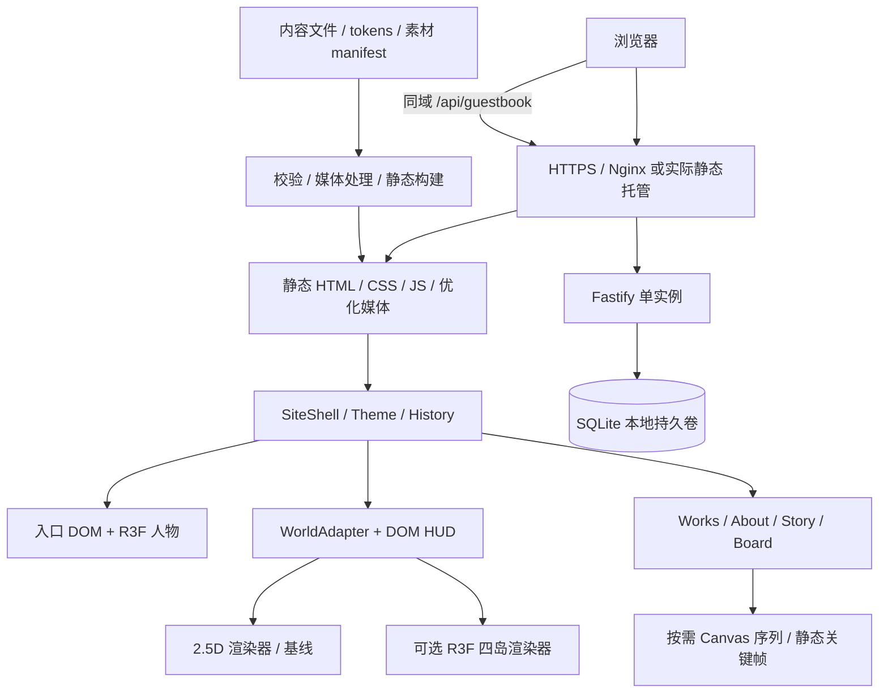
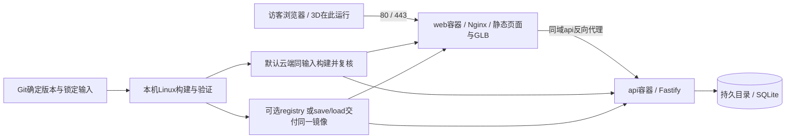

# SYYH Signal · 完整设计、实施、素材与部署方案（五阶段合订本）

---

版本：2026-10-12 / handoff-v2。部署正文已合并；先读五阶段计划，再按当前阶段查设计/架构/素材/协作/任务与部署。分册修改后运行 `python scripts/build-agent-handoff.py`。

---

阶段1 draft → 阶段2 修正完善 → 阶段3 素材完善 → 阶段4 正式建设 → 阶段5 正式修补。当前 P1：in_progress。实际实施、验证及部署事实见 [P1交接](../agent-work/phases/P1/handoff.md)。历史设计正文与当前执行事实分开记录。


---

> 执行更新（2026-10-12）：用户已启动阶段1，并明确授权本机开发、GitHub交付与云端Docker部署。本文中的“本轮未开始/云端默认阶段4”为原规划时状态；当前范围以 [阶段1执行交接](../agent-work/phases/P1/handoff.md) 和 phases/tasks.json 为准。阶段2–5尚未启动。

## SYYH Signal · 完整设计与实施交接包

版本：2026-10-12 / handoff-v2（五阶段整合版）。适用项目：`D:/dev/yyh_server/SYYhSite`。

本包汇总已完成的设计初稿，供后续 ChatGPT 与 Grok CLI 接续工作。**本轮只整理方案，没有建立生产网站、制作新模型或执行部署。** 用户此前要求设计图审核后再搭建；“初稿完成”不自动表示全部待定项已选定。后续用户发起实施时按其授权推进，不重复要求已确认事项。

### 阅读顺序

**完整入口是 [complete-plan.md](complete-plan.md)**，已合并部署正文与五阶段计划。后续先看阶段目标与边界，再查对应技术细节；分册是同一内容的维护源，无需把部署视为另一个项目。

| 文件 | 用途 |
|---|---|
| [07-phased-plan.md](07-phased-plan.md) | 用户指定的五阶段：draft、修正、素材、正式建设、正式修补 |
| [01-design.md](01-design.md) | 全站设计、页面、日夜主题、四岛、交互与待定项 |
| [02-implementation.md](02-implementation.md) | 架构、技术选型、模块与接口、数据、性能及部署 |
| [03-assets.md](03-assets.md) | 全量素材清单、图片生成、Blender 制作、搜索与验收 |
| [04-collaboration.md](04-collaboration.md) | 两个 agent 的职责、文件归属、任务交接和本机工具 |
| [05-taskboard.md](05-taskboard.md) | 五阶段31项任务、依赖、完成定义与验收矩阵 |
| [06-development-deployment.md](06-development-deployment.md) | 已指定Ubuntu服务器、本机Linux容器验证、Git/镜像交付、Compose与回滚 |
| [deployment-facts.json](deployment-facts.json) | 2026-10-12本机与服务器只读检查事实，区分已验证与未验证 |
| [complete-plan.md](complete-plan.md) | 以上全部正文的单文件合订本，便于连续阅读与交接 |
| [decisions.json](decisions.json) | 明确要求、建议方案及未定决定，便于 agent 读取 |
| [asset-manifest.json](asset-manifest.json) | 已有资产与拟制作资产的状态、用途、责任人与路径 |
| [tasks.json](tasks.json) | 初始任务队列；所有实施任务仍未开始 |
| [phases.json](phases.json) | 五阶段状态与输入/交接；P1已启动，后续阶段待执行 |
| [prompts/chatgpt-lead.md](prompts/chatgpt-lead.md) | ChatGPT 统筹 agent 启动提示词 |
| [prompts/grok-research.md](prompts/grok-research.md) | Grok 首轮资料与素材研究提示词 |
| [prompts/grok-coding.md](prompts/grok-coding.md) | Grok 一般编码任务提示词 |

### 设计图入口

- [全站初稿画廊](../../design/review-v1/index.html)：入口、Hub、四频道、详情、手机与开场分镜。
- [Day / Night 与四岛画廊](../../design/review-v2/index.html)：双主题和四张岛屿概念图。
- [可视交接首页](index.html)：直接用浏览器打开，汇总文档与关键图片。

**阅读旧图时的修正：** VISITOR ACCESS 右侧线稿人物只是占位，正式需求为可跟随鼠标的真实 3D 人物，形象后续设计。Hub 四岛必须有四种指定风格，但完整 3D 世界仍是可选方案。旧图的示例作品、个人资料、账号和留言不代表用户事实。

### 当前可直接复用的成果

全站 1440px 设计图、390px 手机版关键视图、开场分镜；四岛各一张 Day/Night 双联概念图；候选双主题 tokens 与对比检查；图像生成提示词；品牌与组件设计资料；参考站研究记录；入口 3D 人物交互说明。详见素材清单，图片并不等于 GLB 或已实现交互。

参考站地址与研究状态见 [原研究报告](../reference-notes.md)。本包不把源码阅读当作已实测全部浏览器动画；Grok 任务包含补齐实际桌面/手机观察。

### 用户确定的工作分工

**ChatGPT：** 统筹、设计判断、图片生成、使用本机 Blender 做模型/渲染、核心代码、集成与最终验证。

**Grok CLI：** 搜集素材/信息、记录来源与使用条件、完成已划定接口的一般编码，并提交可复现的自检结果。

图片生成由 ChatGPT 完成，不把生成任务交给 Grok。已有 Blender 技术工作流原地复用，不复制 `D:/social_impact` 的人物、影片、凭据或完整资料库。

### 尚需输入或选择

| 项目 | 状态 | 影响 |
|---|---|---|
| 入口人物形象、服装、风格、半身/全身 | 待后续设计 | 暂不能制作正式角色；可先完成代理模型与控制器 |
| 四岛 → Works/About/Story/Board 对应 | 未确定 | 配置字段保留空值；开发用 A–D 标注，先做可配置导航 |
| 四岛完整 3D / 2.5D | 未确定 | 先统一 WorldAdapter 接口；推荐先做 2.5D 可用基线，3D 经选择后增加 |
| 用户真实作品、简介、时间线、联系方式 | 未提供完整资料 | 页面结构可先做，生产发布需真实内容或诚实空状态 |
| Story 的具体故事 | 待设计 | 先实现关键帧阅读与播放器接口，不预制整套序列 |
| Docker部署目标 | 已指定 `ubuntu@124.220.190.120` / Ubuntu24.04 / linux/amd64 | 优先本机验证+Git固定输入+云端构建；镜像交付按带宽/构建实测选择，详见06 |
| 域名、镜像仓库、公开发布 | 未指定或未验证 | 可以准备本地构建与部署配置，实际发布另按用户指令 |

只有对应的最终素材或部署依赖这些决定；工程骨架、主题、导航、一般页面、接口及代理验证均可独立推进。

阶段1/2使用现有概念和明确的开发占位验证运行流程；阶段3集中补正式素材；阶段4完成正式集成与生产交付；阶段5处理当次补丁。启动指定阶段默认只执行该阶段，连续阶段按用户明确范围推进。本轮仅合并和规划，不开始阶段1。

### 文档优先级与证据

用户最新明确指令 > 本包明确要求与决策状态 > `visitor-avatar-plan.md` > v2 增量 > v1 > 原始品牌/草稿。`docs/HANDOFF.md` 是历史云端交接，保留参考地址，其“从未读取参考站”已被后续研究部分更新。`prototype/` 是历史设计演示，不是正式实现。

本轮检查：Blender 可执行文件为 4.5.13 LTS；Grok CLI 为 1.0.46；已读本机 Blender skill 及早期验证 README。当前 Blender MCP 状态检查未连通，**不代表建模能力不存在**，也不是重新安装要求。下次建模先检查实际工程与插件连接。本轮未运行网站构建、浏览器验收或新模型验收。

部署补充：已读取引用服务器任务和 `D:/dev/yyh_server/server.md`，再次SSH只读确认云端Docker/Compose与空容器状态。本机WSL2 Ubuntu已存在，但Docker运行能力尚未验证；完整流程和边界见06。未安装或部署。

---

> 执行更新（2026-10-12）：用户已启动阶段1，并明确授权本机开发、GitHub交付与云端Docker部署。本文中的“本轮未开始/云端默认阶段4”为原规划时状态；当前范围以 [阶段1执行交接](../agent-work/phases/P1/handoff.md) 和 phases/tasks.json 为准。阶段2–5尚未启动。

## 五阶段实施计划

这是用户指定的阶段划分，替代此前四个里程碑。完整方案已包含设计、代码架构、素材流程、协作、任务和部署正文；后续工作按本章阶段启动。

当前状态：**计划已整理，阶段1尚未开始。** 现有 `prototype/` 和静态设计图是历史设计材料，不计为阶段1已交付。所有阶段采用同一项目和可复用架构；draft完成后继续迭代，避免阶段4从零再写一套。

### 五阶段总览

| 阶段 | 用户名称 | 主要目的 | 可审查交付 | 部署范围 |
|---|---|---|---|---|
| 1 | draft第一版网站 | 把初稿变成可运行的完整浏览流程 | `draft-v1`、实际截图、运行命令、占位清单 | 本机开发与Linux Docker验证 |
| 2 | 第一版网站修正和完善 | 根据实际浏览与反馈修正设计/交互，冻结第一版范围 | `draft-v1-reviewed`、修正记录、素材需求与接口基线 | 本机回归；部署选择与检查清单完善 |
| 3 | 素材的完善和补充 | 把占位替换为可交付的正式图片、模型和内容资源 | `assets-v1`、源文件、GLB/媒体、manifest、来源与验收 | 本机生成/Blender/网页素材预览 |
| 4 | 第一版正式网站建设 | 正式素材与数据集成，完成生产能力和Docker交付 | `v1.0.0-rc`→验收后的`v1.0.0`、发布记录、运行/回滚方案 | 本机生产验证；按该阶段授权执行Ubuntu部署/复核 |
| 5 | 第一版正式网站修正和补充 | 根据正式版使用结果修错、优化和补内容 | `v1.0.x`、变更与回归记录、更新素材/内容 | 每次先本机验证，再按发布范围更新云端 |

版本名是约定，是否创建Git tag由后续任务指令决定。此轮没有提交/tag/推送/部署。

### 阶段1：draft第一版网站

**目标：** 可以真实点击、输入、探索、进入和返回的第一版网站，先验证页面关系和关键交互。

**工作内容：**

1. 核实本机WSL2/Docker运行能力，建立Next/React/TS正式可复用工程、锁文件、内容schema、双主题tokens和基本Dockerfile/Compose。Grok拿到明确接口和文件归属。
2. 做Intro/Visitor Access、Hub、Works列表/详情、About/Paper、Story阅读版、Board、404和正常URL。全站Day/Night可切换并保存，手机基本可用。
3. 入口放真实3D代理人形，先跑通头/眼/上身有限幅跟随、待机/回正、灯光和海报降级；代理外观不被视为最终角色。
4. 四岛先用现有概念图/简化图层做2.5D探索，跑通x/y旅行、聚焦后进入、辅助链接、触摸、History与视角恢复。完整3D仍是待选分支。
5. 内容用明确标记的开发fixture或诚实空状态。频道绑定未定时可用独立draft绑定配置验证闭环，并在页面/报告标注“临时”，不得写入最终决定。
6. 留言先做最小真实本地Fastify/SQLite链路：提交待审核、仅已审核公开、基础验证、持久化和必要失败状态；开发测试留言不进入正式数据。生产限流/审核工具/备份恢复在阶段4完善。
7. 本机跑Linux生产构建与容器预览，验证主要路径、主题、人物代理和数据重启；记录实际截图与已知缺口。

**ChatGPT：** 架构、主题/路由、人物代理、旅行/状态、最小留言服务、Docker与整体验证。**Grok：** 必要参考研究、通用UI与普通页面排版、开发样例整理及自检。

**交付：** 可运行的draft、320/390/768/1440关键截图、运行/容器命令、初始检查结果、开发fixture与代理清单、下一阶段修正列表。

**完成条件：** 所有频道结构和深链能打开；主浏览流程闭环；Day/Night刷新保留；3D代理跟随有效；手机/键盘与失败降级可用；本机容器构建/启动通过。页面的未完成素材/开发内容明确可见，不声称已正式上线。

人物最终身份、四岛完整3D和Story全序列不作为该阶段前置。正式模型/大批图帧制作和云端公开发布不属于本阶段默认范围。

### 阶段2：第一版网站修正和完善

**输入：** 阶段1可运行版本、截图与问题清单，以及用户已有或新增反馈。

**工作内容：** 修正版式/中文换行/日夜对比/手机版；调人物与世界跟随手感、聚焦/点击/触摸和返回；补齐加载/空/失败/键盘状态；做适当性能与减少动态回归；收敛第一版功能范围与内容结构。

将反馈写为可执行问题：页面/复现步骤、预期、实际、优先级、修复与证据。修正不止改设计图，应落到运行中的draft。draft代理测试不能替代最终素材性能测试。

该阶段整理或落实四岛频道绑定、世界2.5D/完整3D、人物形象brief、Story静态/序列、首批真实内容字段。已确认选择不重复问；未定事项标注局部依赖与推荐选项，不让页面修复整体停住。发布设计仍保留用户明确要求的真实3D入口角色。

**部署工作：** 固定Docker/运行配置方向、所选基础image候选、目标平台和待测项。优先保留“本机验证→Git固定输入→Ubuntu构建”的流程；原站直连超时不否定腾讯mirror拉取。具体云端pull/构建/上传测速仅在该阶段请求包含验证时执行；否则带入阶段4，不把未测写为通过。

**交付：** 修正后的draft、问题关闭/未关闭记录、关键流程回归、第一版范围和接口/配置基线、阶段3素材brief及清单。

**完成条件：** 阻断浏览流程的问题已解决；版式/交互达到本轮反馈要求；正式素材需求足够具体可执行；仍未定项有明确影响。最终人物设计输入未齐时仅对应素材任务等待，不阻塞其他修正。

### 阶段3：素材的完善和补充

**输入：** 阶段2素材需求、选定视觉与内容事实。参考图来源和生成输入有记录。

**工作内容：**

1. ChatGPT生成正式角色母版、多视图/材质参考及必要品牌/Story图片，原地复用本机Blender skill完成角色建模、绑定、待机、GLB、rig-map和Day/Night海报。
2. 四岛补为同轮廓的Day/Night透明/分层运行图；若完整3D已选择，制作白盒→正式模型→LOD/锚点/碰撞体/GLB。不因拥有Blender就默认增加全3D分支。
3. 根据第一版范围补Story关键帧和正文；选择序列时先短章试制，再同场景/同资产版本渲染完整序列，保留源工程与manifest。
4. Grok检索/核实字体、必要环境/纹理/可选音效和使用条件；整理用户真实作品/简介/链接。ChatGPT负责所有图片生成，Grok不伪造用户事实。
5. 生成尺寸组、压缩运行资源、保留源文件/脚本/提示词，更新asset manifest。在专用预览或draft测试位置检查真实网页加载、姿态、灯光、alpha、裁切与预算。

**交付：** 可编辑源图/`.blend`/脚本、正式GLB与绑定映射、四岛/角色日夜海报、优化媒体/字体、可选Story序列、真实内容文件、来源/许可、实际技术与视觉验收报告。

**完成条件：** 所选第一版所需素材可定位、加载与使用；角色正式身份/外观/动作合格；四岛一致性与辨识度合格；真实内容或诚实空状态确定；未知许可素材不发布。未选的全3D/序列不作为完成要求。正式入口角色若未完成，必须保留缺口，不能用代理或海报宣称该需求满足。

本阶段以资产生产与预览验收为主；全站正式资源联调和云端部署放到阶段4。

### 阶段4：第一版正式网站建设

**输入：** 经修正的draft、第一版范围/接口、阶段3正式素材和内容。继续同一工程，替换开发配置/fixture，补齐生产行为。

**工作内容：**

1. 全站集成正式角色与四岛、字体/媒体/用户内容和所选Story功能；确认最终频道绑定，开发fixture与临时内容不进入公开构建。
2. 完善留言限流、幂等、审核CLI、输入/输出隔离、迁移、持久化、在线备份与独立恢复；补齐相关前端状态。
3. 完善metadata/分享图、图片尺寸/懒加载、真实媒体性能、模型/帧缓存与资源释放、无障碍、减少动态和全部错误降级。
4. 完成生产Dockerfile/Compose、固定基础/依赖/构建参数、配置/权限/日志/健康检查；从确定版本输入构建候选，并在本机Linux容器完整验证。
5. 准备release manifest、源码/媒体取得方式、运行命令和回滚目标。默认云端获取确定Git版本，按同一锁定输入构建；选择传镜像时记录实际包/带宽或registry digest。
6. 该阶段启动请求包含部署时，复核服务器资源与端口、腾讯mirror实际选定tag拉取、Git/npm、冷/热构建时间/峰值内存；按实测选择路线并Compose运行。核验公网、数据、域名/TLS与回滚。仅要求本地正式建设时，交候选和待执行部署清单，明确状态。

**交付：** `v1.0.0-rc`候选、全套验收证据、发布清单、备份恢复/回滚记录；对应发布范围完成验收后为`v1.0.0`。云端部署已执行或未执行、IP预览或正式域名、TLS就绪与否分别记录。

**完成条件：** 第一版选定需求全部满足，正式3D角色已替换代理；真实内容与运行资源无误；本机生产Docker通过；所授权的云端部署与公开访问复核完成；数据持久化/恢复可复现。未获域名或发布指令时不冒称正式上线。

### 阶段5：第一版正式网站修正和补充

**输入：** 第一版运行结果、实际用户反馈与具体补充需求。

**工作内容：** 重现并修复页面/交互/API/加载/设备问题，补用户内容与遗漏素材，优化真实表现，必要时回到Blender或图片生成工具修资产。每次补充仍遵循原角色身份、主题、频道配置与第一版接口，架构扩张或新功能另记范围。

本机先修复→跑受影响回归与构建→必要时完整浏览流程→固定补丁版本→按发布范围云端构建/更新→检查线上结果和数据。迁移先备份，失败恢复上一可用image/config；应用回滚不自动覆盖数据库。

**交付：** `v1.0.x`补丁、变更清单、关闭/未关闭问题、受影响素材/内容版本与回归/发布记录。

**完成条件：** 当次指定问题/补充已处理，未影响既有核心功能和数据；所有实际发布步骤验证。此阶段是一轮一轮的具体工作，不创建无人要求的自动巡检或无限维护任务。

### 启动、阶段范围与交接

后续可直接说“开始阶段1：draft第一版网站”“开始阶段2，根据这些反馈修正……”等。**启动某一阶段默认完成该阶段授权范围，不自动跨到后续阶段；如果用户明确授权连续阶段或全部工作，按该范围持续推进，无需重复申请已授权步骤。** 本次仅制定计划，不表示启动阶段1。

每阶段由ChatGPT统筹分配Grok的一般任务，自己完成图片/Blender/核心代码与最终验证。task-id使用 `P1-01`…`P5-05`，同一阶段可以按依赖并行，跨阶段未完成的局部输入明确标注。

每阶段收尾生成 `docs/agent-work/phases/P<n>/handoff.md`，内容为实际版本与文件、运行/预览路径、截图与检查、已完成/未完成、用户决定、资产/接口状态、下一阶段输入。该文件未来执行时创建，不提前填“通过”。

进度记录在 [phases.json](phases.json)；执行细项在 [tasks.json](tasks.json) 与 [05-taskboard.md](05-taskboard.md)。状态由lead更新，不以预算、计划或上一阶段检查冒充本阶段完成。

### 部署在五阶段中的位置

| 阶段 | 做什么 | 验证证据 |
|---|---|---|
| 1 | 本机Docker可用、同技术栈最小构建/启动 | 实际image平台、容器启动、主路径与重启测试 |
| 2 | 修正容器/接口问题，固定部署输入/检查项 | 本机回归；远程未测项目标注pending |
| 3 | 优化发布媒体、确定源与运行资产版本 | 字节/宽高/模型指标、网页资产预览 |
| 4 | 完整生产验证、Git/云端构建、Compose及所授权发布 | 镜像/Git/配置记录、构建资源、云端健康/公网/数据 |
| 5 | 补丁发布与必要回滚/恢复 | 修复前后证据、回归、线上复核与数据状态 |

完整技术命令、镜像传输估算、腾讯mirror与registry区别、持久化/回滚要求已并入合订本的“本机编程、Docker验证与Ubuntu部署流程”章节；分册 [06-development-deployment.md](06-development-deployment.md) 是同一正文的维护源。

---

## 完整设计方案

### 定位与结构

SYYH Signal 是一个可以“调入”的个人频道：接通信号，认识站点主人，探索四座悬浮岛，再进入作品、自述、故事与留言。整体为成熟动漫、街头广播与漫画版式；内容以中文为主，英文大标题塑造节奏，少量日文作为装饰。原创视觉吸收参考站的空间层次与引导方式，不复制角色、图片或整套界面。

主流程：`Intro → VISITOR ACCESS → Hub → 聚焦岛 → 内容频道 → 返回原视角`。作品详情和其他内容均有真实 URL，允许分享直达。昵称是可选游客称呼，没有注册、登录或访客账户。

### 设计图使用规则

现有图见 [v1 画廊](../../design/review-v1/index.html) 与 [v2 画廊](../../design/review-v2/index.html)。v1 定页面布局，v2 定 Day/Night 与岛屿造型方向；[入口人物说明](../visitor-avatar-plan.md) 修正 v1 的右侧人物。所有图是关键视口，长内容继续自然向下滚动。

| 页面 / 图号 | 正式设计与主要状态 |
|---|---|
| Intro / 10 | 信号线、框、标题、操作提示四段，目标约 3.5s。始终可跳过，会话中只自动播放一次；减少动态直接跳过 |
| VISITOR ACCESS / 01 | 桌面左侧大标题、说明、可选昵称、进入按钮；右侧约 3:4 真实 3D 人物。加载中先展示人物海报；失败仍可进入 |
| Hub / 02 | 广阔天空、四个不同轮廓浮岛、精确路径线、频道标签；左上简短指引、右上小地图、底部辅助操作。只给当前聚焦岛强提示 |
| Works / 03 | 首推作品大图与右侧概要，下面编号作品列表。作品为空、图像失败、加载状态均保留可读标题 |
| Work detail / 04 | 大主图、真实介绍、角色/媒介/年份与过程图；上一件/下一件；返回恢复原列表滚动和焦点 |
| About / 05、06 | 姓名与一句自述、人物图、兴趣工具与时间线，正常阅读。Paper 是此页局部阅读样式 |
| Story / 07 | 三章节 SIGNAL / ASCENT / ARRIVAL 为初稿结构，具体故事待定；关键帧、字幕、章节进度。滚动序列增强可后置 |
| Board / 08 | 可验证的联系方式与真实留言；空列表、编辑、提交中、待审核成功、限流、失败状态。不存在的账号不做可点击假链接 |
| Mobile / 09 | 从 320px 起支持，390px 为参考；入口上下布局或缩小人物，Hub 拖动，作品单列。触摸按钮至少 44×44 CSS px |
| 404 | NO SIGNAL，返回 Hub 与内容目录；正常 HTTP 404 |

### 双主题视觉规范

全站固定提供 `Day / Night`，默认 Night；保存用户选择，刷新后恢复。Day 为蓝白明亮氛围，Night 为现有暗黑广播氛围。主题同时作用于 DOM、插图方案与 3D 灯光；不创建第二套网站。

| 语义 token | Day | Night |
|---|---|---|
| void / 页面底 | `#EDF6FF` | `#0A0A0E` |
| surface / 面板 | `#FFFFFF` | `#15151C` |
| raised | `#E3F0FF` | `#1F1F29` |
| ink / 正文 | `#143453` | `#F3F1EA` |
| muted | `#526B84` | `#A3A2AD` |
| primary | `#145EC4` | `#C8FF2E` |
| on-primary | `#FFFFFF` | `#0A0A0E` |
| focus | `#145EC4` | `#FFD60A` |
| 控件边框 | `#5E7B96` | `#A3A2AD` |
| 装饰细线 | `#9DB8CF` | `#555560` |
| sky / fog | `#D9EDFF` / `#EDF6FF` | `#080D1B` / `#0A0A0E` |

权威候选值在 [theme-proposal.json](../../design/review-v2/theme-proposal.json)，实施时由 ChatGPT 合并到 `design/tokens.json` 并扩展已有生成器，生成文件不手改。现有对比计算针对候选纯色：正文 Day 11.68、Night 17.49；实际透明层、图片叠字、hover、focus、disabled 仍需重新验收。细线只作装饰，不能替代控件边界。

保留 CH-01 黄、CH-02 粉、CH-03 青、CH-04 绿的频道识别，Day 中按对比需求调整前景色或背景衬底，不直接把浅色霓虹当正文。单屏以背景和文字为主，强色用于动作与焦点。

英文标题建议 Barlow Condensed Heavy Italic，桌面 72–120px、手机 40–64px；中文正文用 Noto Sans SC 或足够覆盖中文的自托管字体，16px 起、约 1.7 行高；HUD 使用 DotGothic16/monospace，仅元信息可 11–13px。字体是候选，Grok 核实授权、字重和中文覆盖后 ChatGPT 定稿，不用不足字集承载所有中文。标题与控件使用简洁框角、斜切和硬偏移阴影；网点和扫描线限制在不妨碍阅读的位置。

### 四座岛屿设计

| 风格 / 资产 ID | 构图与辨识点 | Day / Night | 后续制作重点 |
|---|---|---|---|
| 天空之城 / island-sky | 高耸象牙白城堡、蓝色屋顶、桥与花园、细瀑布、纵深较长岛底；四岛中最竖直 | 蓝白空气感 / 蓝紫天空与暖窗光 | 大轮廓、主塔、桥、瀑布层分离，入口避开尖塔 |
| 远古地貌 / island-ancient | 宽阔分层岩台、峡谷、石柱、风化拱门、青绿水面、巨型破损石环与少量遗迹 | 天光显岩层 / 冷月色与稀疏遗迹信号 | 岩层几何、石环剪影、水体边界；不堆满建筑 |
| 末日星球 / island-apocalypse | 破碎行星壳、弧形残片、陨坑、废弃工业站与天线、橙色裂隙 | 苍冷日光保留裂隙 / 深空与橙色发光 | 裂隙 emissive mask、大残片、少量慢漂浮碎石；避免全屏强闪 |
| 二次元宅岛 / island-anime-home | 原创温馨创作宅、桌面显示器、漫画与书架、游戏小物、屋顶树与休憩角 | 清透蓝白住宅 / 暖室内光与蓝色外缘 | 房屋与桌面主形、局部室内剖视；书脊和摆件采用原创符号 |

四张概念图均已生成，位于 `design/review-v2/islands/`。左右分别 Day/Night，是气氛与造型参考；两侧细节不能当作完全一致的建模正投影。正式模型以同一几何重打光；2.5D 也应使用同一批准轮廓，不能因主题切换导致建筑突然增减。

**四岛风格与四频道的映射尚未决定。** 使用稳定的资产 ID 与独立 channel ID；`island.channelId` 等待填写，不把“天空之城=Works”等猜测写死。岛名与频道名分别出现在配置中。

### 人物跟随鼠标

对象仅指 VISITOR ACCESS 右侧人物。真实骨骼模型、固定镜头；眼睛先看向指针，头部较慢跟随，上身轻微响应，叠加呼吸和眨眼。初值：头左右 ±15–20°、上下 ±8–12°，上身 ±3–5°，均待模型实测。

入口容器接收指针位置，归一化后映射到限幅目标，控制器按 `dt` 平滑求姿态。离开入口区域后回正；Canvas 不拦截表单。Day 柔和蓝白灯、Night 保留面部补光；人物形象不随主题改变。手机以待机为主，减少动态静止。人物形象及半身/全身构图后续设计，旧线稿不默认成为最终角色。

### 旅行、聚焦与跳转

地图鼠标 x/y、滚轮 x/y、触摸拖动、键盘方向键均写入同一相机目标；HUD 和进入按钮区域暂停旅行目标更新。世界有边界与阻尼，接近岛后温和吸附并用不同的进入/退出阈值保持焦点稳定。离开地图保留位置。

默认旅行由移动完成，**普通点击远岛不移动视角**；抵达并聚焦后点击或 Enter 才进入内容。触摸以移动距离区分拖拽与点击。辅助频道列表是正常链接，可直接打开频道，用于轻量模式和键盘访问。

进入流程：验证聚焦岛 → 锁旅行输入 → 保存视角 → 约 0.65–1s 揭幕/接近 → 切换 URL → 内容标题获得焦点。返回 Hub 恢复快照；浏览器 Back/Forward 和深链同样有效。没有快照则安全总览。转场失败解除锁并用正常链接继续。

### 动态与可访问性

浮岛轻微错相漂浮，初值约 6px/5s；聚焦路径约 400–600ms。原型旧闪屏改为局部边缘扫光。音频默认关闭，用户主动开启后才播放；无音频素材时不呈现虚假的可播放状态。

减少动态关闭入口、漂浮、惯性、扫描线及滚动序列，以静态关键帧和直接导航完成任务。提供暂停视角、跳过入口、轻量模式；Tab 顺序清晰，焦点可见，状态有文字与编号，图像有替代文字。内容页保留原生滚动；Hub 专用手势不得影响表单、正文或浏览器导航。

手机/低端设备/WebGL 失败仍能看作品、读简介、留言和分享。设计质量最终用真实人物、真实内容与目标屏宽复核；现有概念图或对比数字不能代替实际运行验收。

---

## 完整实施方案：架构、选型与接口

下列目录、类型和命令是后续拟建规范，不表示已有生产实现。ChatGPT 负责落实与锁定，Grok 按已冻结的接口完成一般模块。

部署事实更新：用户已指定 `ubuntu@124.220.190.120` 的Ubuntu24.04服务器，并要求运行在Docker中。具体编程、Linux生产镜像验证、Git/镜像交付和Compose流程以 [06-development-deployment.md](06-development-deployment.md) 为准；域名/证书与镜像仓库仍待落实。

实施按 [五阶段计划](07-phased-plan.md) 分步进行：阶段1建可继续复用的draft骨架与基本容器；阶段2修正和冻结第一版接口；阶段3完善正式素材；阶段4落实下文完整生产能力和所授权部署；阶段5补丁修正。此文是最终技术目标，不要求阶段1一次完成全部生产功能。

### 架构

采用 **Next.js App Router + React + TypeScript 静态内容站**；入口人物使用 **Three.js / React Three Fiber（R3F）/ GLB**；Hub 通过统一 WorldAdapter 支持 2.5D 基线与可选完整 3D；动效用 GSAP；独立 Fastify + SQLite 服务处理公开留言。CSS Modules 配合现有 tokens，不引入第二套视觉系统。



路由、正文与表单始终是 DOM。WebGL 是人物和可选世界的增强层，不承担文字排版或网站能否访问的唯一入口。

### 技术选型

| 层 | 选择 | 实施约束 |
|---|---|---|
| 前端 | Next.js 稳定版、React、TypeScript | `output: 'export'`、`trailingSlash: true`；版本开始实施时按官方兼容范围锁定 |
| 包管理 | pnpm workspace + lockfile | 根应用 + `services/guestbook`；ChatGPT 独占依赖与 lockfile 修改，Node LTS 版本写入环境说明 |
| 样式 | CSS Modules、CSS variables、现有 tokens generator | tokens 扩展 day/night/paper；生成器保持可重放 |
| 人物 3D | Three.js、R3F、必要的 Drei 工具、glTF loader | 懒加载客户端组件，构建阶段不触碰 window/GPU；先确保代理模型通路 |
| Hub | 2.5D 图层/DOM + 统一旅行控制器 | 这是未决定完整 3D 时的建议基线，不改变四岛设计 |
| 可选 Hub 3D | R3F + 同一世界状态契约 | 经用户选择后制作模型与 3D adapter；不并行维护两套导航状态 |
| 转场 | GSAP timeline / ScrollTrigger | 路由揭幕、开场和 Story；运动对象只有一个写入者 |
| 内容 | 类型校验 JSON；长说明可选本地 MDX | 优先用现有数据需求，MDX 只接受仓库可信作者，不执行游客输入 |
| 媒体 | Sharp 构建前生成 picture/srcset | AVIF/WebP + PNG/JPEG 回退，明确宽高、裁切与 loading |
| API | Fastify + JSON schema + 限流插件 | 输入校验、幂等、审核隔离、真实错误状态由 ChatGPT 实现 |
| 数据库 | SQLite + `better-sqlite3` 候选驱动 | 实施时核实 Node/native module 兼容性；容器内安装，WAL/backup 用安全 API |
| 测试 | Vitest + Playwright | 测控制算法、关键流程与服务，不为纯样式组件堆实现镜像测试 |
| 运行 | Nginx / HTTPS、Docker Compose | 用户已要求Docker，目标Ubuntu服务器已定；先提供同一Linux生产镜像的本机验证和可复现配置 |

静态导出不能承载动态 POST 服务、Server Actions 或默认服务端图像优化；作品 `[slug]` 在构建时枚举。留言独立运行，图片预处理。[Next.js 官方静态导出文档](https://nextjs.org/docs/app/guides/static-exports)

### 目录与核心责任

```text
SYYhSite/
  app/                         # ChatGPT：layout、page 路由、metadata、404
    hub/ works/ works/[slug]/ about/ story/ board/
  src/
    components/ui/             # Grok：已定规范的 Button/Frame/EmptyState 等
    components/layout/         # ChatGPT：常驻 HUD、导航、错误边界
    features/gate/avatar/      # ChatGPT：人物与骨骼控制
    features/world/            # ChatGPT：旅行、聚焦、WorldAdapter、2.5D
    features/world3d/          # ChatGPT：可选 3D renderer
    features/works/            # Grok：列表、详情展示
    features/about/            # Grok：资料与时间线展示
    features/story/            # ChatGPT：缓存/播放器；Grok：静态章节排版
    features/board/            # ChatGPT：提交/API；Grok：纯展示列表、联系条目
    state/ lib/contracts/      # ChatGPT：主题、session、schema、公共契约
    content/                   # Grok：真实资料规范化；ChatGPT：schema
  public/media/                # 仅经校验的优化成品与运行时 manifest
  assets/source/               # ChatGPT：原图、.blend、脚本、源贴图，按 v001 版本
  assets/research/             # Grok：来源/许可与候选，不自动发布
  scripts/                    # 媒体/验证脚本；token 脚本由 ChatGPT 管
  services/guestbook/          # ChatGPT：服务、迁移、审核 CLI
  deploy/                     # ChatGPT：运行、备份、恢复与配置
  tests/                      # 按任务归属编写，ChatGPT 运行集成验收
  docs/agent-handoff/          # 本包与协作状态
  docs/agent-work/             # 后续任务输入、研究、交接与证据
  design/ prototype/          # 历史设计资产原位保留
```

原 UMD bundle 与 `window.SYYH` 仅为设计参考，逐模块迁移，不以 CDN React 原型作为正式网站。

### 路由、状态与数据契约

| URL | 规则 |
|---|---|
| `/` | 可跳过 Intro + Visitor Access；会话昵称可空 |
| `/hub/` | 总览或恢复快照，语义化频道列表始终可访问 |
| `/works/`、`/works/[slug]/` | 静态列表与详情，刷新、分享、返回均有效 |
| `/about/` | 同一页面的局部 Paper 阅读态 |
| `/story/` | 原生滚动，关键帧阅读基础版与可选序列增强 |
| `/board/` | 联系方式与留言；API 不可用时清楚显示状态 |

URL 决定当前页面；禁止仅用 `screen` state 冒充导航。layout 保存低频会话状态，ref/controller 保存逐帧状态。localStorage 只保存主题、轻量等偏好，读取失败安全回退；sessionStorage 保存昵称、入口已播放与 Hub 快照，版本化校验，坏数据不影响进入。人物资源不因 direct deep link 强制下载。

建议共享类型如下，ChatGPT在P1-02建立初版、P2-04按修正后的范围冻结具体实现：

```ts
type Theme = 'day' | 'night';
type ChannelId = 'works' | 'about' | 'story' | 'board';
type IslandId = 'sky' | 'ancient' | 'apocalypse' | 'anime-home';
type WorldPhase = 'exploring' | 'focused' | 'entering' | 'content' | 'returning';
type WorldSnapshot =
  | { version: 1; mode: 'flat'; center: [number, number]; zoom: number; focusedId: IslandId | null }
  | { version: 1; mode: 'three'; position: [number, number, number]; target: [number, number, number]; focusedId: IslandId | null };
interface WorldAdapter {
  setTheme(theme: Theme): void;
  setPaused(paused: boolean): void;
  restore(snapshot: WorldSnapshot): boolean;
  snapshot(): WorldSnapshot;
  focus(): IslandId | null;
  enter(id: IslandId, signal: AbortSignal): Promise<void>;
  dispose(): void;
}
```

快照不跨渲染模式直接解释；模式不匹配回总览。`enter` 只处理视觉过渡，NavigationController 负责唯一 router 跳转。频道绑定空值时开发显示未绑定，发布时四频道必须有可用语义入口。

内容最低契约：Work 包含 `slug/title/summary/year/media/role/body/status`；Media 包含 `src/width/height/alt/credit/assetId`；Profile 包含真实 `name/bio/interests/timeline/links`；Story 包含章名、正文、poster、可选 frames；Link 只允许已验证 https/mailto 等协议。内容 schema 与样例由 lead 先交付，Grok 才编页面。`status: draft` 内容不导出公开列表和 sitemap。

### 人物核心实现

`AvatarCanvas` 透明背景、固定相机；`AvatarAsset` 负责加载、骨架实例与海报；`AvatarController` 唯一写最终骨骼；`AvatarLighting` 依据 Theme 设置两套光照。

入口 pointermove → 相对容器归一化 → 限幅目标 → 按时间阻尼 → 基础待机姿态叠加头/眼/上身偏移。先 update AnimationMixer，再基于当帧基础姿态求最终四元数，不累积旋转，不让 mixer 与跟随分别覆盖骨骼。GLB 的真实骨骼轴、正前方和 bind pose 由 config 映射，不按名称猜模型轴向。

眨眼只占对应 morph/眼睑，待机 clip 不覆盖跟随使用的最终结果。单一 `useFrame` 驱动，不每帧 setState。离开区域、窗口失焦、减少动态、模型失败与卸载均有明确处理。人物灯光可调，但材质、发型和身份不随主题变更。

先用本机 Blender 制作可回读代理人形验证眼/头动作，待角色设计确定再替换正式 GLB；代理阶段合格不等于正式美术完成。

### Hub 控制与进入

Pointer/Wheel/Touch/Keyboard 共用 InputController，统一给 CameraController 目标值；视角更新有 clamp、dt 上限及暂停恢复。2.5D 以世界坐标平移/缩放图层；3D 以观察目标 + 固定斜上偏移求相机。全 3D 的 docking view、入口轨迹、模型碰撞体在白盒阶段校准，二维像素半径不能直接套到米制模型。

FOCUSED 由停靠距离、进出阈值和稳定时间决定，不由一次 hover/raycast 决定。点击再验证 focusedId、拖动距离、asset ready 和输入锁。进入中 GSAP 只驱动过渡参数，由唯一控制器写 transform/camera。完成、异常、Abort 或卸载时均释放锁。

所有频道有正常链接；无 JS 可浏览静态内容，Hub 本身以目录降级。返回、刷新、旋屏与 renderer 模式变化均校验快照。路由离开暂停场景；人物和 Hub 不同时持续运行两套高负载 renderer。

### Story 两阶段

先做 3–6 张关键帧 + 三章完整正文；后做获选故事的滚动序列。首屏和 Hub 不预载序列。桌面 120–180 帧/1280×720、手机 60–90 帧/640×360 是候选预算，制作前用一个短章验证压缩与解码成本。

Canvas 的 DPR 与尺寸分别设限；帧索引 clamp，上一成功帧兜底。帧缓存 desktop 约 16 张720p、mobile 约12张360p；720p RGBA 单张约3.5MiB，不能全量解码。使用 LRU、有界并发解码、及时关闭淘汰的 ImageBitmap、取消过期请求；章节切换和卸载释放缓存。用户减少动态/轻量、素材缺失或 Save-Data 提示时显示静态正文。ScrollTrigger 卸载清理，不引入第二套全局平滑滚动器。

### 留言接口与服务

- `GET /api/guestbook?cursor=...&limit=20`：只返回 approved，稳定 created_at/id 排序，返回 `items,nextCursor`；limit 上限50。
- `POST /api/guestbook`：`{callsign,message,submissionId,website?}`；空昵称转 GUEST，昵称1–24 Unicode码点，消息1–140码点，trim 后验证；website 是隐藏 honeypot，不作真实资料。
- 新提交返回202 `{id,status:'pending'}`；同 submissionId + 同请求返回原结果，不重复插入；同 ID 不同内容返回409。413/422/429/5xx 提供可读提示，失败保留表单，429 包含 Retry-After。

表字段：`id, submission_id UNIQUE, callsign, message, status, created_at, reviewed_at`；status 为 pending/approved/rejected。参数化 SQL，纯文本 DOM 渲染，无 HTML/MDX。禁止 public GET 泄露 pending 或审核字段中的内部资料。

同域接口、允许来源校验、合理 body 上限与速率限制；反向代理可信 IP 配置明确，不能信任任意客户端 X-Forwarded-For。速率计数只作必要使用，敏感请求信息不进公开日志。服务端审核 CLI/list/approve/reject 为首版管理方式，管理员权限不放入前端。迁移可重复且启动检查，生产数据不随 deploy 覆盖。

SQLite 单实例、同机本地持久盘；容器重启持久化。备份使用驱动 backup 或 SQLite 在线备份能力，恢复到独立目录校验 approved/pending 数据；不得仅复制运行中 WAL 数据库的主文件。多实例需求出现后另选 PostgreSQL，不提前引入 Redis。具体 SQLite 版本及已知修复在实施开始时核对。[SQLite WAL 官方说明](https://www.sqlite.org/wal.html)

### 资源与性能目标

| 对象 | 初始预算 / 策略（均待实测） |
|---|---|
| DOM 首屏 | 优先标题/控件与250KB量级主海报；不要为等待 GLB 挡住游客按钮 |
| 人物 | GLB 含贴图候选≤4MB，约30k–60k triangles；从代理实测再调；桌面 DPR≤1.5，手机≤1–1.25 |
| 2.5D Hub | 四岛图按视距/设备加载，一张图不为全站重复下载；大面积透明叠层与模糊受控 |
| 可选3D Hub | 全场景可见约150k–250k triangles、draw calls≤100；单岛GLB含贴图1–3MB候选，优先低LOD |
| Story | 当前章窗口缓存，不全量预载/解码 |
| 内容页 | 目标移动 LCP≤2.5s、INP≤200ms、CLS≤0.1；真实设备采样验证 |
| 渲染 | 常见桌面目标60fps，目标手机至少稳定30fps；记录设备/分辨率/耗时，失败即降低质量或用静态模式 |

压缩传输大小与显存分别计量；1024² RGBA纹理约4MiB，mipmap另加约1/3；加载失败、context lost、隐藏标签页都可回退和恢复。共享 geometry/material 缓存需明确所有权，不在一个实例卸载时误 dispose 其他实例资源。

浮动/待机开启时需要连续帧；完全静态时才使用按需绘制。实例化、LOD 与资源复用遵循 [R3F 性能文档](https://r3f.docs.pmnd.rs/advanced/scaling-performance)。预算为本项目建议，不是库保证或已经测出的成绩。

### 构建与部署交付

实施后统一提供 scripts：`dev / build / typecheck / lint / test / test:e2e / media:build / assets:verify` 与 guestbook 独立命令。当前 package.json 只有 tokens/draft，后续 agent 不把上述拟建命令写成已经可用。

pnpm install 使用锁定依赖；静态导出路由与媒体校验通过后产生 out/。Nginx 正确匹配 trailing-slash HTML、返回404，`/api/` 保留路径转发 Fastify；HTTPS、压缩、hash媒体长缓存与HTML短缓存按实际托管配置。Compose 挂载本地数据库卷，提供健康检查、优雅关闭、迁移、备份/恢复命令、env.example（无真实密钥）。

浏览器 CSP 允许必要的自托管资源与主题初始化方式；不靠无限放开策略解决。API 开发代理与实际生产同域路径一致。目标服务器已定，当前先交付本地可审查结果和对应Docker方案；域名/TLS与实际公开发布按用户后续指令落实。

---

## 素材设计、生成与制作方案

阶段安排：P1/P2复用现有概念与明确占位，仅制作必要代理验证；P3按冻结brief集中生成/建模/完善正式资产并预览验收；P4做全站正式集成；P5按当次补充修资产。详细范围见 [五阶段计划](07-phased-plan.md)。以下为素材规范，不表示提前启动P3。

### 责任与素材原则

图片生成由 **ChatGPT 使用内置 imagegen** 完成；Grok CLI 负责参考研究、可用素材检索、来源/许可记录和一般处理脚本。本机 Blender 已安装且 GPT 操作能力已验证，ChatGPT 使用 Blender MCP / Blender Python 制作、导出和渲染本项目模型。

历史证据证明可创建、修改、保存、渲染及做程序化人形走位/运镜，**不等于本项目正式角色的拓扑、绑定和网页表现已经验收**。正式资产逐项制作与检查。图片不会自动成为可转动 GLB，模型也不会自动具备自然视线跟随。

优先原创角色、岛屿、Story 图与品牌图。检索主要用于字体、HDRI、纹理、音效和制作参考；参考图不默认成为可发布素材。Grok 搜索结果标记 provenance，不将作者不明图片写为用户作品。

### 已有素材与缺口

| ID / 类别 | 当前成果 | 后续产物 | 责任 |
|---|---|---|---|
| review-site | v1 11张页面/分镜 PNG + SVG、画廊 | 作为布局基准；随真实素材做最终截图 | ChatGPT |
| review-theme | 日/夜/对照图、theme JSON、对比结果 | 合并并生成正式 tokens | ChatGPT |
| island-sky | 天空之城 Day/Night 双联 PNG | 单岛透明或分层图；可选 GLB/LOD/碰撞体 | ChatGPT |
| island-ancient | 远古地貌 Day/Night 双联 PNG | 同上 | ChatGPT |
| island-apocalypse | 末日星球 Day/Night 双联 PNG | 同上 | ChatGPT |
| island-anime-home | 二次元宅岛 Day/Night 双联 PNG | 同上 | ChatGPT |
| visitor-avatar | 只有旧布局占位线稿，无正式形象 | 设定图、.blend、绑定GLB、两主题海报、rig mapping | ChatGPT，待人物设计 |
| story | 章节结构与占位画面 | 3–6关键帧、完整正文；可选滚动序列 | ChatGPT，待故事设计 |
| profile/works | 示意资料和作品 | 用户真实内容、授权图、缩略图与详情图 | 用户提供事实；Grok整理 |
| brand/og | 标题与基础线条规范 | logo字标/SVG、favicon、1200×630分享图 | ChatGPT设计；Grok一般代码 |
| fonts | 候选字体名称 | WOFF2、license、字集/字重记录 | Grok搜索；ChatGPT整合 |
| environment | 主题色、灯光概念 | 灯光preset；确需时小HDRI/天空贴图 | ChatGPT；Grok搜索 |
| textures | 四岛材质概念 | 岩石、金属、木材等贴图atlas与emissive mask | ChatGPT制作/调整；Grok搜索 |
| audio | SOUND OFF设计状态，无已准备音效 | 可选进入/聚焦短音效及来源记录 | Grok搜索；ChatGPT集成 |

机器清单见 [asset-manifest.json](asset-manifest.json)。概念源图保留在 `design/review-v2/islands/`，不要直接把10MB以上的四张双联图全量塞进首屏。

### 共用资产目录与记录

```text
assets/source/<asset-id>/v001/
  brief.md                   # 本次设计目标、约束、引用
  references.json            # 来源、用途、图片/模型版本
  prompts.json               # 实际生成提示词及输入参考
  concept/                   # 原始生成图
  blender/source.blend       # 如制作模型，保存可编辑工程
  blender/build.py export.py  # 实际执行脚本
  textures/                  # 源贴图及颜色空间说明
  renders/                   # 从该工程实际渲染的日夜海报/预览
  validation.json            # 真实统计、问题与验收状态
public/media/<asset-id>/<version-or-hash>/
  *.glb / *.webp / *.avif / *.png / manifest.json
assets/research/<task-id>/
  candidates.json sources.md # Grok候选与许可，不自动进入public
```

asset记录至少包含 id、用途、owner、status、sourcePath、runtimePath、版本、宽高/三角数/材质数/大小、引用/生成工具、许可或来源状态、生成日期、是否通过视觉/网页验证。未知数填 null，不能填0冒充测量。来源路径和运行时 URL 分开，浏览器不暴露本机绝对目录。

新版本递增，不覆盖已审查母版。资产移动/改名同步 manifest；源文件与生成脚本可定位到实际发布版本。大 `.blend` 与图帧是否进 Git/LFS 按真实大小确定，未被仓库保存的源工程另做明确备份清单。

### 图片生成流程

1. ChatGPT 读取已审设计与资产 brief，选择本轮需要的输出。四岛沿用 [已有最终提示词](../../design/review-v2/image-prompts.json) 和对应概念图，避免重新发散。
2. 明确画幅、主体边界、视角、光照、空间、材质、背景与负面约束。原画尽量不生成最终UI文字，频道标签与按钮由代码渲染。
3. 用内置 imagegen 生成新图或基于已有图编辑；修改现有图时绑定正确参考图，保留主体身份与轮廓。需要透明 cutout 时明确透明输出。
4. 查看实际成图，检查透视、数量、完整岛底、角色左右与手部、视觉辨识、重复物体、边缘和文字污染。保留本次提示词与结果，失败记录具体区域，定点返工。
5. 图像改背景、补画或透明化继续使用 imagegen；Sharp只做格式、尺寸与压缩等运行时媒体处理，不用脚本冒充生成/编辑工具。
6. 转换图片尺寸组、填写 alt 与来源，接入实际页面后再确认裁切、画质、日夜与手机表现。

#### 四岛运行时图设计

统一三分之四观察角、主体完整、透明背景可叠到主题天空。四岛保持同一视觉世界，但轮廓分别为高塔、横向岩台、破碎弧壳、温馨房宅；不要让它们都变成相似小城堡。

2.5D 可分岛底/主建筑/前景小物/光效少量层，建议每岛2–4层；层间空白与缩放原点一致，用实际世界位置实现视差。小岛远景仅保留1层降级图。避免把双联图当成两层或大量堆叠巨型透明PNG。

Day/Night 必须保留一致轮廓。生成工具若难以保持精确几何一致，可先由 Blender 建简化模型，用同一相机分别渲染两套光照生成2.5D图；这是制作手段，不意味着 Hub 自动改为全3D。

#### 入口角色图设计（形象确定后执行）

人物 brief 包含风格（动漫/半写实等）、原创身份、脸与发型、服装、配色、配件、比例、表情、可见范围和禁改特征。先出视觉母版，再参考母版生成正/侧/背全身建模参考、面部细节与材质板，检查跨视图一致性。生成的多视图不是精确工程图，无法一致的部分由建模阶段统一。

设计图须为眼睛、颈部与肩部转动留空间；头发和衣领不遮住所有面部。复杂摆件/飘带先简化，正式质量通过局部近景和网页姿态验收。固定镜头采用半身还是全身由后续设计确定。海报由最终模型同构图实际渲染，避免图片中的脸与GLB呈现不同身份。

#### Story 图设计

在故事确定后写三章镜头 brief（场景、机位、运动、光照、字幕、安全画幅）；先3–6张关键帧保证正文可读。序列推荐用 Blender 同一场景沿可复现镜头路径渲染；不逐帧独立生成导致建筑和人物跳变。必须使用实际源工程和同一资产版本。全量制作前先试一短章，验证手机裁切、帧间连续性与预算。

### Blender 本机流程

已验证 skill：[`D:/social_impact/mymovie/.agents/skills/blender-codex/SKILL.md`](D:/social_impact/mymovie/.agents/skills/blender-codex/SKILL.md)。原地读取其 production / connection-recovery / project-baseline，保持 skill 相对链接在原目录解析。该目录规则要求原地引用，不复制一套新的权威手册。

实际检查：`C:/Program Files/Blender Foundation/Blender 4.5/blender.exe --version` 返回4.5.13 LTS；2026-10-12 MCP状态检查未连通。开始建模时发现实际工具，读取 addon/scene/current filepath；需要 `user_prompt` 时传用户当前目标原文。当前场景正确才写入；保存新工程到本项目 `assets/source/`，不覆盖或清空其他作品。

连接失败按该 skill 恢复手册处理，或使用已有可执行文件的后台 Blender Python 工作流；无需把 `bpy` 交给系统 Python，也无需假定图像/视频生成API。后台进程从已保存工程读取，长任务记录日志，避免超时后重复创建。已有技术脚本可阅读借鉴，调整输出路径与断言后再执行，不能直接在历史验证目录重跑。

本项目输出必须包含：实际 `.blend`、执行脚本、正式导出GLB（如果目标为实时3D）、源贴图、海报、真实统计与验证报告。只有代码、MCP端口、视口截图或文件名均不能单独证明成品通过。

#### 入口人物模型制作

| 阶段 | 实际交付 / 验收 |
|---|---|
| A 代理验证 | 基本人形与可控头/眼/上身；网页GLB加载、限幅/回正/海报失败降级。只验证通路 |
| B 形象冻结 | 母版与多视图、材质/比例约束，后续新角色不自动继承历史演员身份 |
| C 建模 | 可编辑模型，合理面部/关节拓扑，面部与头发细节先于不可见背面小物；检查法线/穿插 |
| D 材质 | 网页适用材质、适量atlas、baseColor/normal/roughness/emissive用途与颜色空间；不能假定Blender节点全部可导出 |
| E 绑定 | root/hips/spine/chest/neck/head + 两眼骨或眼球对象；可选眼睑morph。记录实际骨骼、local axes、基准姿态 |
| F 待机 | 低幅呼吸与眨眼，必要时分别动画通道；idle循环接缝平滑，跟随无抖动 |
| G 导出 | 选定对象GLB、应用合适变换、检查glTF轴向/比例，骨骼动画/必要shape keys实际加载可用 |
| H 浏览器验收 | 三种屏宽、Day/Night、左右上下、离开回正、待机叠加、加载失败、减少动态与资源释放 |

骨骼名称通过 `rig-map.json` 映射，示例语义：root、head、neck、chest、eyeLeft、eyeRight、blinkLeft、blinkRight；不存在的功能填 null 并采用已定义降级，不能声称支持未绑定动作。待机与跟随由AvatarController一处合成最终姿态。

建议初始预算：30k–60k三角、GLB含贴图≤4MB、贴图一般1K/必要面部2K，实际根据质量/设备调整；先避免实时复杂毛发、布料、骨骼物理和重后处理。预算不是硬件保证。保存正面、左/右最大跟随、抬/低头与手机实际截图，模型质感在浏览器中验收，不只看Blender渲染。

#### 可选四岛完整3D

全3D选择后执行：四岛白盒与统一相机 → 主体轮廓 → 材质/实例化小物 → 灯光/局部动画 → LOD/碰撞体/入口锚点 → GLB与网页验收。

约定 `ISLAND_ROOT`、主体/小物/发光组、`DOCK_ANCHOR`、`ENTRY_ANCHOR` 与简化碰撞体；导出时功能锚点写入单独配置或保留命名空对象。单位、原点、包围盒、各岛尺度在scene manifest明确。细远景文字留DOM，不烘焙不可读文字。

LOD建议主场景与远景两级起步，不为看不到的细节做三份高模；重复窗、树和小物可实例化，核实导出后是否保留或由运行时重新实例化。几何压缩与KTX2/Basis等贴图压缩只在加载器/解码器和目标设备验证后启用；压缩文件不代表低显存。日夜只切光照与发光参数，不下载第二套几何。

每岛初始GLB含贴图预算1–3MB，全场景150k–250k三角/draw calls≤100为候选目标；记录实际值，超标优先减少不可见小物、透明叠层与动态阴影。没有WebGL时用同模型日夜海报和正常频道链接。

### Grok 搜索与素材接纳

搜索顺序：素材作者/官方资源站与许可证原文 → 确认下载规格与来源 → 记录候选 → 选可用版本 → 本地处理/网页验收。字体检查实际字重、中文覆盖、WOFF2与许可文件；HDRI检查分辨率/体积与本项目是否真的需要；纹理检查贴图类型与颜色空间；音效检查可用时长、格式与循环接缝。

每条候选记录 `{id,category,title,sourceUrl,author,licenseName,licenseUrl,allowedUse,attribution,downloadUrl,localPath,checkedAt,decision}`。没有查到许可填 unknown、仅参考；有使用条件则保留要求，实施者落实署名。动态来源重新检查，不把搜索摘要当许可证据。原站示例人物、游戏官方图和用户照片不互相替代身份。

Grok不需要访问图像生成密钥；现有内置图像工具由ChatGPT使用。音频是可选增强，可先上线无音频完整站点。用户个人素材缺失时按事实留空，不用搜索替用户伪造履历或作品。

### 素材验收与交付

1. **完整性：** manifest路径存在、运行时路径有效、版本一致、源工程可打开、源提示词/脚本可定位。
2. **视觉：** 四岛轮廓清楚、主题身份稳定；人物身份/姿态一致、无明显穿插；Story连续且字幕可读。
3. **技术：** 真实宽高/字节/三角数/材质数/动画名统计；加载器兼容、alpha边缘无黑框、纹理颜色正确、海报降级有效。
4. **运行：** 渲染与首屏预算、资源释放、错误/断网/隐藏页面处理；不把模型文件大小当显存。
5. **来源：** 可发布素材来源与条件明确，生成资产记录工具与参考；未通过候选不进入public构建。

ChatGPT最终给出各资产“已完成/已验证/待补/失败原因”及实际路径。高质量正式人形或全3D世界若某环节达不到标准，先用代理/海报维持可运行结果，明确缺口后继续修正；不能把技术预演当正式交付。

---

> 执行更新（2026-10-12）：用户已启动阶段1，并明确授权本机开发、GitHub交付与云端Docker部署。本文中的“本轮未开始/云端默认阶段4”为原规划时状态；当前范围以 [阶段1执行交接](../agent-work/phases/P1/handoff.md) 和 phases/tasks.json 为准。阶段2–5尚未启动。

## ChatGPT × Grok CLI 协作方案

Docker与服务器工作沿用相同分工：ChatGPT维护Dockerfile/Compose、生产镜像验证、版本与回滚、SSH部署和最终复核；Grok负责研究与已分配的一般模块。部署流程见 [06-development-deployment.md](06-development-deployment.md)。本轮未启动这两位agent执行实施。

按 [五阶段计划](07-phased-plan.md) 分配工作：P1/P2先draft与修正，P3集中素材，P4正式集成和所授权部署，P5具体补丁。当前阶段未启动。用户只启动一个阶段时不自动执行后续阶段；授权连续阶段则按其范围推进。

### 两个主要 agent

| 工作 | ChatGPT / lead | Grok CLI |
|---|---|---|
| 统筹与设计 | 决策状态、任务拆分、接口冻结、视觉定稿 | 研究记录与建议，不自动覆盖已定需求 |
| 图片 | 全部图片生成、修改与实际成图检查 | 搜索参考/可用辅助素材，不接图片生成 |
| Blender | 连接检查、模型、绑定、渲染、GLB、网页检验 | 资料/许可/建模参考搜集，必要的非核心处理脚本 |
| 核心代码 | 架构、路由/History、theme、旅行、人物控制、播放器缓存、API/DB | 按冻结契约开发普通展示组件与页面内容 |
| 验证 | 集成、浏览器、性能、降级、数据持久化和最终验收 | 对自己任务做类型/样例/必要行为自检并记录 |
| 交付 | 合并/接受任务、完整预览、构建与上线配置 | 文件清单、命令/输出、来源和遗留问题 |

ChatGPT对最终结果负责；Grok的“完成”表示等待lead复核，不能自动当成合格。可在两份任务互不依赖时并行开展，核心接口有变化则先记录并交接。

### 文件归属与并发

ChatGPT专属共享文件：根package.json、pnpm-lock.yaml、workspace配置、next/ts配置、tokens及generator、app路由、src/state、src/lib/contracts、核心world/avatar/sequence、API/DB/deploy。Grok不为一个页面自行修改这些文件或加依赖，需要时在交接中列出建议，由lead执行。

Grok任务限定文件集，例如 `src/features/works/**` 与其局部CSS；UI与About可独立成任务。禁止两个agent同时改同一个文件。任务开始前记录owner、allowlist、接口版本；完成后释放归属。

优先在同一仓库以不重叠文件合作，便于现有本机工具使用。需要完全隔离时由lead建立合适Git worktree并明确路径/基线；当前不是新增worktree要求。先检查已有dirty文件，保留用户修改；不执行reset/clean、覆盖原型或批量删除历史资产。提交/推送/发布根据当次用户指令，不凭任务模板推定授权。

### 任务状态

`pending → assigned → in_progress → ready_for_review → accepted`；确实等待用户素材为 `waiting_input`，失败为 `needs_fix`。初始化队列见 [tasks.json](tasks.json)，本轮没有任务进入实施状态。

**lead单独维护公共tasks.json。** Grok在 `docs/agent-work/reports/<task-id>.md` 提交状态与报告，避免并发改队列。每次分配写 `docs/agent-work/assignments/<task-id>.md`，至少包含：目标、owner、依赖、输入、允许修改的绝对/项目相对路径、禁止改动的共享接口、验收条件、当前contract版本。

报告格式：实际完成内容；文件列表；实际运行命令和结果；输入事实/来源；视觉或运行证据路径；未完成/失败；接口或依赖变更建议。没有运行就写未运行，不能写“理论上通过”。lead接收后审差异、跑必要集成测试、更新tasks与资产状态。修复只重跑受影响验证。

### 本机工具

| 工具 | 已检查状态 / 用法 |
|---|---|
| Grok | `C:/Users/yonghao.yu/.grok/bin/grok.exe`，1.0.46；已读取 `--help` 与 `agent --help` |
| Grok单任务 | 顶层 `--cwd`、`-p/--single`、`--output-format`、`--no-subagents` 在本机帮助中存在；非交互prompt用顶层 `-p`，不虚构 `grok agent --prompt` |
| Blender | `C:/Program Files/Blender Foundation/Blender 4.5/blender.exe`，4.5.13 LTS；不在PATH仍可用绝对路径 |
| Blender skill | `D:/social_impact/mymovie/.agents/skills/blender-codex/SKILL.md`，原地读取；技术验证目录为previs_test / previs_walk_3s / previs_walk_15s |
| Blender MCP | 工具已暴露；本轮addon状态检查未连通。建模启动时检查运行中的Blender插件与当前工程 |

本轮只确认CLI可执行和help，不代表Grok登录、搜索网络或编码任务已经实际验收。运行时若认证或网络失败，记录实际错误，保留其他可继续任务；不重新安装已可用工具来代替诊断。

#### 启动Grok研究任务

用户发起后续实施/研究时，可使用以下PowerShell命令。提示词文件是UTF-8，多行作为一个参数传入，无需拼shell字符串：

阶段内先由lead写明当前phase/task-id的研究assignment，再启动下述命令；用户明确要求独立研究时按其范围执行。研究模板不能自动接管五个阶段或提前做所有素材。

```powershell
$taskPromptPath = 'D:\dev\yyh_server\SYYhSite\docs\agent-handoff\prompts\grok-research.md'
$taskPromptText = Get-Content -LiteralPath $taskPromptPath -Raw -Encoding utf8
& 'C:\Users\yonghao.yu\.grok\bin\grok.exe' --cwd 'D:\dev\yyh_server\SYYhSite' --no-subagents -p $taskPromptText
```

一般编码同理换 `grok-coding.md`，但必须先存在lead的任务assignment，不能让Grok自行接管全部代码。交互模式可直接启动 `grok --cwd ...` 并输入同一提示词。单次模式的输出是任务结果，不应假设它会持续守候新任务；后续通过新调用或已确认的resume方式接续。

不固定Grok模型ID或reasoning选项，沿用用户配置；不读取或输出认证凭据。模型/CLI能力以当前help为准。两个主agent是本项目协作安排，本包未实际启动任何额外agent。

### Grok按阶段研究内容

1. P1-03/P2：访问四参考站，按1440/390截图与实际可操作内容记录入口、旅行、作品、阅读和滚动；失败如实记录，不拿HTTP200当动画验收。
2. 对照现有 `docs/reference-notes.md` 补研究缺口，不再次无条件照搬旧“云端全被阻止”状态。
3. P3-05：从作者/官方源搜字体、必要HDRI/纹理/短音效，输出可用候选与许可原文地址；未分配P3时不自动开展大批正式素材任务。
4. 查本机所选前端/模型压缩工具兼容文档，给出依赖建议；不为研究任务安装全套生产依赖。
5. P3-06及后续内容补丁：用户真实资料只做结构化整理；缺少就列缺口，不网上拼凑用户身份。

### 变更与风险处理

主题、四岛绑定、人物、world renderer等决定分别记录。已确认的选择不重复请求；未定资产只影响其正式制作，其他任务继续。用户新指令优先，lead同步docs/decisions与对应任务，不让Grok继续按旧接口返工。

发现重大设计/数据/资源问题由Grok交给lead，lead修正方案或具体实现并提供可审查结果。核心行为不靠“先做完后再猜”：未聚焦点击、主题闪烁、History返回、骨骼叠加、留言审核隔离、资源生命周期均在早期验证。

---

> 执行更新（2026-10-12）：用户已启动阶段1，并明确授权本机开发、GitHub交付与云端Docker部署。本文中的“本轮未开始/云端默认阶段4”为原规划时状态；当前范围以 [阶段1执行交接](../agent-work/phases/P1/handoff.md) 和 phases/tasks.json 为准。阶段2–5尚未启动。

## 五阶段任务与验收清单

阶段定义以 [07-phased-plan.md](07-phased-plan.md) 为准，执行队列为 [tasks.json](tasks.json)，阶段状态为 [phases.json](phases.json)。此前四个里程碑和T00–T18已被本表替代；不是两套同时执行的任务。当前全部pending，用户本轮只要求整理计划。

### 执行任务

| ID | owner | 前置 | 交付与完成定义 |
|---|---|---|---|
| P1-01 环境与工作基线 | ChatGPT | 本阶段启动 | 核实dirty/设计输入/WSL2与本机Docker，分配文件；记录未验证工具。 |
| P1-02 draft工程与公共契约 | ChatGPT | P1-01 | Next/TS/pnpm、schema、Day/Night、基本Dockerfile/Compose可复用；提供Grok接口样例。 |
| P1-03 参考增量与普通UI/页面 | Grok | P1-02 | 必要参考增量，Button/Frame与Works/About/Story阅读/Board展示；fixture标记、移动/键盘可用。 |
| P1-04 入口路由与Hub旅行 | ChatGPT | P1-02 | 真实URL/Intro/Gate/404、2.5D四岛、聚焦进入/返回/History、辅助链接与临时绑定隔离。 |
| P1-05 3D代理人物与跟随 | ChatGPT | P1-02 | Blender代理GLB、眼头/上身限幅跟随、待机/回正、日夜灯光、手机/海报降级。 |
| P1-06 最小本地留言链路 | ChatGPT | P1-02 | Fastify/SQLite基础验证、pending提交、approved读取、本地持久化和失败状态。 |
| P1-07 draft集成与阶段交付 | ChatGPT | P1-03,P1-04,P1-05,P1-06 | draft-v1主流程/主题/屏宽检查、本机Linux构建/Compose/重启，截图、缺口与阶段交接。 |
| P2-01 反馈与问题分解 | ChatGPT | P1-07 | 实际复现用户反馈，记录预期/实际/优先级/归属，不把方案推测写成缺陷。 |
| P2-02 页面与普通组件修正 | Grok | P2-01 | 按任务修布局/中文/主题/手机/状态，记录实际自检；没有改动需求则说明已检查结果。 |
| P2-03 核心交互与性能修正 | ChatGPT | P2-01 | 旅行/聚焦/History/人物手感、加载/错误/减少动态与适当性能修正，跑受影响检查。 |
| P2-04 第一版范围和素材brief | ChatGPT | P2-02,P2-03 | 记录频道绑定/renderer/角色/Story/内容决定，冻结props/schema，列阶段3局部待输入与部署检查项。 |
| P2-05 修正版回归与交接 | ChatGPT | P2-04 | draft-v1-reviewed截图、问题记录、关键回归、素材与接口基线；云端未测项仍pending。 |
| P3-01 角色设定与图片生成 | ChatGPT | P2-05 | 正式角色brief/母版/多视图/材质与构图；实际成图检查，保存提示词/参考。 |
| P3-02 正式角色Blender与GLB | ChatGPT | P3-01,P1-05 | .blend/脚本/材质/绑定/idle/GLB/rig-map/日夜海报，网页姿态与预算验证。 |
| P3-03 四岛正式运行素材 | ChatGPT | P2-05 | 一致轮廓日夜透明/分层图；仅选定时增加完整3D模型/LOD/锚点等，记录验证。 |
| P3-04 Story与品牌图素材 | ChatGPT | P2-05 | 所选关键帧/品牌/分享图；选序列时短章试制后完整渲染，保留源与manifest。 |
| P3-05 辅助素材检索与本地化 | Grok | P2-05 | 字体/必要纹理环境/可选音效来源许可、已接纳资源本地化和一般媒体处理。 |
| P3-06 真实内容规范化 | Grok | P2-05 | 用户works/profile/links/story转schema，媒体credit/alt齐全，事实缺失不伪造。 |
| P3-07 资产验收与阶段交接 | ChatGPT | P3-02,P3-03,P3-04,P3-05,P3-06 | assets-v1、源/运行文件清单、技术/视觉/网页预览、许可与缺口；正式角色不以代理替代。 |
| P4-01 正式核心与素材集成 | ChatGPT | P3-07 | 正式Avatar/Hub/主题/History、所选world3D或序列播放器/缓存、资源释放和降级。 |
| P4-02 正式页面与内容集成 | Grok | P3-07 | 按冻结接口替换开发内容/临时绑定，Works/About/联系/Story排版与媒体状态、无障碍自检。 |
| P4-03 生产留言与数据能力 | ChatGPT | P3-07 | 限流/幂等/审核CLI、迁移/日志/安全渲染、持久化/在线备份/独立恢复及前端状态。 |
| P4-04 生产Docker与发布输入 | ChatGPT | P3-07 | 最终Dockerfile/Compose、平台/base/lock/参数、配置/权限/健康检查/日志、release与回滚输入。 |
| P4-05 正式候选完整验收 | ChatGPT | P4-01,P4-02,P4-03,P4-04 | v1.0.0-rc完整浏览器/类型/构建/API/媒体/性能/失败/数据检查，本机Linux生产容器通过。 |
| P4-06 Ubuntu部署与云端复核 | ChatGPT | P4-05 | 授权范围内mirror实际pull/Git/npm/构建资源实测、固定版本部署、健康/公网/数据/DNS/TLS与回滚复核。 |
| P4-07 第一版正式交付 | ChatGPT | P4-05；部署范围内另需P4-06 | 版本/截图/证据/发布与备份回滚说明；部署在范围内则还需P4-06，不在范围内明确未上线。 |
| P5-01 正式版反馈复现与范围 | ChatGPT | P4-07 | 建立当次问题/内容/素材补充清单，归属/优先级，记录运行版本与预期。 |
| P5-02 普通页面与内容补丁 | Grok | P5-01 | 按分配修页面/组件/真实内容与辅助资源，实际自检；无此类任务时记录不适用。 |
| P5-03 核心与素材补丁 | ChatGPT | P5-01 | 修核心/API/性能/模型/图像，保持身份/契约与数据；按范围更新源和manifest。 |
| P5-04 补丁回归与发布输入 | ChatGPT | P5-01；另需当次已选修复任务 | 已选修复P5-02/P5-03完成后跑回归/构建，固定v1.0.x输入、备份/回滚与发布记录。 |
| P5-05 补丁更新与阶段交接 | ChatGPT | P5-04 | 按授权发布范围更新云端并复核，或交本地补丁；关闭问题、留证据，不开展未要求无限维护。 |

每阶段阶段启动范围以用户指令为准。任务输入未齐仅影响对应资产/发布，其他独立任务可继续。P4-06云端部署及P5可选修复类别按范围选择，未执行填pending或有理由的not_applicable，不冒称完成。选择完整3D或序列后，lead在对应阶段任务内补子任务、依赖与完成条件。

### 分阶段检查重点

| 阶段 | 必须检查的结果 |
|---|---|
| 1 draft | 各页/深链和进入返回闭环；双主题；3D代理跟随；基础手机/键盘/降级；本机Linux构建/容器；本地留言持久化 |
| 2 修正版 | 按反馈问题回归，中文/日夜/触摸/焦点/减少动态；范围、配置、接口与素材brief足够明确 |
| 3 素材 | 源/运行文件和版本一致，正式角色身份/绑定/光照，四岛轮廓与主题，真实内容/alt/来源，实际网页素材预览 |
| 4 正式版 | 全部正式资源/所选增强、本机生产镜像、完整API与备份恢复、性能/失败场景；所授权云端访问/DNS/TLS/数据与回滚 |
| 5 补丁 | 修复可复现且关闭；受影响回归和必要全流程；数据/资产/版本正确；实际更新后线上复核 |

### 完整验收矩阵

| 类别 | 最低验证 |
|---|---|
| 路由 | Gate→Hub→四频道→详情→返回、详情刷新、Back/Forward、无JS内容链接、404 |
| 主题 | 默认Night、Day切换/刷新、不闪错主题；各页/控件/灯光一致；storage不可用；Paper局部态 |
| 人物 | 左右上下限幅、不抖动、离开回正、不挡输入；idle合成、海报失败降级、卸载停止渲染；阶段1用代理，阶段3/4验证正式角色 |
| Hub | x/y指针与滚轮、HUD暂停、远岛点击不移动、focused才进入、触摸拖动不误入、键盘/辅助链接、快照恢复 |
| 内容 | 真实或诚实空状态，图像失败、alt、长中文、原生正文滚动、详情返回焦点；正式构建不含开发fixture |
| Story | 阅读版可用；所选序列帧边界/失败/缓存/旋屏/卸载/减少动态有效 |
| 留言 | Unicode/空白/HTML纯文本、安全渲染、幂等/冲突、限流/失败保留、pending隔离、审核后可见 |
| 数据 | 重启持久化、迁移重跑、在线备份与独立恢复；正式数据与draft数据分离 |
| 屏宽/输入 | 320/390/768/1440、触摸/细指针、缩放/旋屏、键盘与可见焦点 |
| 降级 | 减少动态、轻量、断网、GLB失败/WebGL/context lost、后台暂停 |
| 性能与部署 | 实际设备/网络/DPR/媒体字节/frame time；Linux平台/base/lock/参数；云端选定tag pull/构建资源与公开访问按阶段范围实测 |

Vitest优先测控制算法与API契约，Playwright测关键流程和截图；实际质感、自然跟随和目标手机性能需要查看。各阶段按素材和改动跑有意义的检查，不要求draft拥有全部生产能力，也不让最终版沿用代理结果冒充验收。

### 阶段交付记录

lead记录Git/素材/接口/配置版本、实际命令/结果、截图/预览路径、已完成/未完成、用户决定、下一阶段输入。交接路径：`docs/agent-work/phases/P1/`…`P5/`。这些目录/报告在后续实际执行时创建，不提前伪造检查结果。

最终v1.0.0要求正式入口3D人物、双主题、四岛选定配置、真实内容或诚实空状态、全部选定功能和生产数据/容器验收。未选全3D/序列不强制；本地候选和真实上线分开报告。阶段5只完成当次补充/修复范围，不默认为长期自动维护。

---

> 执行更新（2026-10-12）：用户已启动阶段1，并明确授权本机开发、GitHub交付与云端Docker部署。本文中的“本轮未开始/云端默认阶段4”为原规划时状态；当前范围以 [阶段1执行交接](../agent-work/phases/P1/handoff.md) 和 phases/tasks.json 为准。阶段2–5尚未启动。

## 本机编程、Docker 验证与 Ubuntu 部署流程

更新：2026-10-12。此方案补充已有完整交接包；**本轮仅梳理流程与只读复核，未安装Docker、推送代码、构建镜像或部署网站。** 用户明确要求网站运行在Docker中，目标服务器已经确定，覆盖旧方案中“托管环境未定”的部分。

本正文已合并进 [complete-plan.md](complete-plan.md)。阶段对应以 [07-phased-plan.md](07-phased-plan.md) 为准：P1基本本机Docker，P2修正/冻结输入，P3资源优化，P4完整生产验证与所授权Ubuntu部署，P5补丁发布/回归。

### 结论

用户提出的“本机开发 → 本机Docker验证 → Git上传 → Ubuntu拉代码构建并运行”可行。需要调整顺序为：**拉取确定版本代码 → Dockerfile内安装依赖和构建镜像 → Compose启动镜像**。依赖在镜像构建时安装，宿主Ubuntu无需再安装Node/pnpm或应用node_modules。

2 vCPU/约3.6GiB内存不等于不能构建本项目；应实测构建峰值内存和耗时。此前对Docker Hub原站的curl超时，也不能推导Docker通过腾讯镜像源拉常用镜像会失败。原站直连、Docker镜像源拉取、应用私有registry是不同访问路径。[Docker镜像源说明](https://docs.docker.com/docker-hub/image-library/mirror/)

当前优先沿用用户原设想：**本机开发 → 固定版本 → 本机Linux容器构建/验证 → Git上传 → Ubuntu获取同一版本 → 按同一Dockerfile与锁定输入构建 → Compose启动 → 云端复核。**

若云端构建实测过慢、影响运行服务或内存不足，再选本机/CI构建+可达镜像仓库push/pull；`docker save → scp → docker load`作为离线/应急备选，不默认每次传全量镜像包。最终选择比较实际传输大小/带宽、冷/热缓存构建时间与峰值内存，不只看机器配置。Dockerfile、Compose服务结构与应用接口保持一致。

### 已验证事实

服务器来源：已读取Codex任务“整理服务器信息与登录指南”，并读 [server.md](D:/dev/yyh_server/server.md)。2026-10-12 14:44（Asia/Shanghai）再次通过SSH只读复核系统、内存、磁盘、Docker、容器与监听端口。

| 项目 | 事实 / 证据范围 | 对流程的影响 |
|---|---|---|
| 云端目标 | `ubuntu@124.220.190.120`，Ubuntu24.04.4 LTS，x86_64 | 统一镜像平台 `linux/amd64` |
| 云端资源 | 2 vCPU（原审计）；约3.6GiB内存，复核时可用约3.1GiB；60GiB盘，剩余约51G | 运行与构建均需实测；规格本身不构成云端构建不可行的证据 |
| Docker | Engine29.6.1、Compose v5.3.1，实际命令返回 | 不需要为本项目重新安装云端Docker |
| 权限 | ubuntu免密sudo；Docker操作按原审计使用 `sudo -n docker ...` | 部署脚本统一使用此方式，不以root SSH或改docker组为前提 |
| 当前服务 | 复核无容器，80/443无监听 | 可规划web端口；部署时仍重新确认，不保证云安全组已放行 |
| 云端网络 | 2026-10-11审计：Docker Hub直连5s超时，腾讯镜像源HTTP200 | 不据原站直连测试否定镜像源拉取；开始时验证选定Node/Nginx具体tag，Git/npm另测 |
| 本机 | Windows11专业版x64、Intel Ultra5 125H、约32GBRAM | 可使用WSL2 Linux容器开发/构建 |
| WSL | 实测Ubuntu发行版为WSL2，当前Stopped | 已有Linux后端基础，不等于Docker引擎已运行 |
| 本机Docker | PATH及系统/用户常见Docker Desktop位置未找到可执行文件 | 先核实是否其他安装位置或WSL内引擎；当前尚不能宣称本机Docker验证可执行 |
| 仓库 | `https://github.com/smallyyh0721/SYYhSite.git`，当前只有设计原型与方案 | 先实施正式工程；Git远程存在不代表服务器拉取权限/网络已验收 |

机器可读摘要见 [deployment-facts.json](deployment-facts.json)。本轮未重新测试镜像源、Git/npm公网连通或云控制台规则，因此这些仍为部署前检查项。

### Windows与Ubuntu的一致性怎样保证

本机Docker必须运行**Linux containers**，使用Docker Desktop的WSL2后端或明确配置的WSL内Linux Docker。不是用Windows容器在本机测试后拿去Ubuntu运行。[Docker WSL2官方说明](https://docs.docker.com/desktop/features/wsl/)

镜像统一 `linux/amd64`，固定Node/pnpm版本、依赖锁文件、基础镜像digest、构建参数与运行入口。容器基础发行版无需恰好是Ubuntu24.04；应用依赖属于镜像内部。容器仍依赖宿主内核与运行环境，网络、权限、挂载、磁盘、端口和浏览器实际表现必须在云端复核。[Docker平台说明](https://docs.docker.com/build/building/multi-platform/)

同一已测镜像直接上线提供最强的产物一致性；服务器从固定源码重新构建也是有效方案。两种方案都要求明确Git/媒体版本、Dockerfile、基础image digest、锁文件和构建参数；服务器重建后补做运行验收。开发态热更新容器与生产验证分开；生产验证禁止挂本机源码或Windows node_modules，否则测到的可能不是镜像内文件。

| 常见差异 | 本项目处理 |
|---|---|
| Windows依赖包含平台二进制 | `.dockerignore`排除node_modules/.next/out；Linux镜像内 `pnpm install --frozen-lockfile`，Sharp/SQLite驱动在Linux安装 |
| glibc/musl | Node构建与API运行阶段先选择同一Debian slim族基础镜像，减少原生模块差异；不为省几MB直接混用Alpine运行API |
| CRLF/BOM | shell脚本LF、无BOM；实施时加 `.gitattributes`；Python/PS脚本按实际解释器运行 |
| 大小写路径 | Docker Linux构建验证import和媒体路径；必要时在WSL Linux文件系统checkout验证大小写问题 |
| bind mount/UID | 开发可挂源码；生产代码/静态资源只进镜像，持久数据挂独立目录并匹配API运行UID |
| `localhost` | 容器间以Compose服务名 `api` 等通信；前端请求同源 `/api/`，不把容器localhost当API宿主 |
| 本机速度/显卡 | 3D与Canvas运行在访客浏览器，云服务器不负责实时渲染模型，也不需装Blender/GPU |

### 编程流程

1. **准备工具：** 核实本机Docker安装路径/WSL内引擎；如需安装，按用户后续启动范围执行Docker Desktop设置。确认 `docker version` 的Server为Linux、Compose/Buildx可用，实际跑最小容器。此轮不执行安装。
2. **建立正式工程：** ChatGPT完成Next静态导出、TS、pnpm lock、公共契约、两主题、Dockerfile/Compose。只安装项目需要的依赖；不把原型CDN bundle直接投入生产。
3. **日常开发：** 页面可在Windows Node或WSL快速热更新；API与SQLite优先Linux容器验证。Grok只改自己分配的一般展示模块；ChatGPT维护依赖/容器配置与核心代码。日常速度优化不能替代生产镜像测试。
4. **素材生产：** 图片与Blender在本机做，发布所需优化媒体和runtime manifest进入构建输入；`.blend`、母版和无关素材库不进入运行镜像。中间媒体需要可复现归档，不只存在个人临时目录。
5. **质量检查：** 类型/关键测试/内容与素材校验；构建全部静态路由、API与健康检查；本机按正式Compose用生产镜像跑全流程。
6. **固定发布输入：** 选择已提交的代码与媒体版本、锁文件和构建参数；release记录Git SHA、独立release ID、镜像ID或registry digest、平台、配置版本与验证结果。相同Git SHA配不同构建参数时不能覆盖旧镜像tag。
7. **交付发布输入：** 默认由Git交付确定源码/配置/媒体版本，服务器按冻结输入构建；选择镜像路线时交付已验证镜像和校验记录。两种方式都包括production Compose、非秘密配置和release manifest，不让服务器随意取移动中的branch HEAD。

如果D盘bind mount在大量文件监听时变慢，可将开发checkout放到WSL的Linux文件系统，通过Windows编辑器访问；lead明确唯一工作目录，先保存现有dirty工作再迁移，不并行维护两份未同步的“主源码”。不用为本项目提前移动现有目录。

### 容器部署结构



推荐两个常驻服务：

- **web：** Nginx提供Next的 `out/`、图片、GLB、字体，反代 `/api/`；不运行Next dev server。正式Dockerfile采用Node builder生成静态产物，final只保留Nginx和运行资源。
- **api：** Fastify+Node+Linux依赖+迁移/审核/备份工具；SQLite作为本地文件，无需增加独立数据库容器。默认只在Compose内部网络暴露API端口。

构建阶段安装完整编译依赖，final API仅包含运行依赖；`better-sqlite3`构建与运行使用一致架构、Node ABI和libc。构建工具不留在final镜像。多阶段构建用于分离构建环境和运行产物。[Docker多阶段构建文档](https://docs.docker.com/build/building/multi-stage/)

Day/Night、GLB、Story都属于静态媒体与浏览器代码。当前静态导出架构无需云端运行Blender、imagegen、Grok或图像预处理。若未来引入服务端渲染，再单独调整web镜像，不因“用了Next”就默认生产运行Node前端进程。

#### Compose文件划分（后续拟建）

| 文件 | 用途 |
|---|---|
| `deploy/Dockerfile` | 多阶段构建，`web` / `api`目标；安装依赖只发生于构建阶段 |
| `deploy/compose.production.yaml` | 只指定确定image，不含build/source bind mount；内部网络、健康检查、restart、日志轮转、持久数据 |
| `deploy/compose.local.yaml` | 覆盖本机web端口（如127.0.0.1:8080），使用独立测试数据卷；仍运行同一生产镜像 |
| `deploy/compose.build.yaml` | build context/target配置，用于本机或服务器构建，不默认用于生产运行 |
| `deploy/compose.dev.yaml` | 可选热更新/源码挂载，独立dev项目，不作为发布验收对象 |
| `deploy/.env.example` | 非秘密配置名与用途；真实env只在本机/服务器受控位置 |
| `deploy/release-manifest.json` | 每次生成，记录代码/镜像/配置/素材版本与校验结果 |

不在整个主Compose默认配置中绑定80，再试图用override改8080而残留两组port。具体Compose编写时验证merge结果；本机与云端的相同点是镜像、服务与接口，不是相同公网端口或数据路径。

### 三种交付路线比较

| 路线 | 过程 | 优点 | 成本与适用 |
|---|---|---|---|
| A 服务器从源码构建 | Git推送→云端取确定commit→镜像内装依赖/构建→启动 | 不必从本机传完整基础/依赖镜像层；已有缓存可复用 | 当前优先，需测选定镜像拉取、Git/npm、构建峰值内存/耗时，并复核云端产物 |
| B 本机镜像离线交付 | 本机构建/测试→Git存档→save/scp/load→启动 | 云端无需访问镜像库/npm做此次发布；上线镜像与本机验证一致 | 全量archive传输/压缩/导入需计时，作为离线或应急备选 |
| C CI+镜像仓库 | Git→Linux CI测试/构建→registry→云端pull确定digest→启动 | 自动化、可追溯、不占云端构建资源 | 先验收双方网络、认证和registry权限；本机应测试CI产物或明确分层证据。建议稳定后采用 |

腾讯Docker镜像源可用于Docker Hub镜像的镜像/缓存访问；原站直连超时不等于常用镜像无法拉取。它与发布本项目自建image的GHCR/腾讯TCR等registry作用不同，不能用基础镜像加速器自动存储/交付自己的私有image。具体tag、Git/npm与自建image仓库分别验证。路线B全部image已传入时可不依赖云端镜像拉取；公网访问、DNS/TLS仍需复核。

### 镜像传输时间与带宽比较

当前没有本项目生产镜像，也没有测量本机到服务器的有效上传吞吐，**不能给出真实传完时间**。应以实际传送的 `.tar` / 压缩包字节数估算，不能拿 `docker image ls` 的展开体积当传输大小。registry push的实际数据有压缩，进度显示的大小也不一定等于线路上传字节。[Docker push说明](https://docs.docker.com/reference/cli/docker/image/push/)

计算式：`传输秒数 ≈ 实际文件MB × 8 ÷ 稳定有效Mbps`，MB/GB在此采用十进制，1GB=1000MB。以下是场景计算，不是本机测速或实际image大小：

| 稳定有效上传吞吐 | 500MB发布包 | 1GB发布包 |
|---|---|---|
| 10Mbps | 6分40秒 | 13分20秒 |
| 20Mbps | 3分20秒 | 6分40秒 |
| 50Mbps | 1分20秒 | 2分40秒 |
| 100Mbps | 40秒 | 1分20秒 |

这是只传文件的时间，完整发布另加导出/压缩、校验和load时间。家用宽带下载速率不能代替上行吞吐；具体路径还受云端接收能力、路由、SSH/磁盘等影响。如果采用标称链路速率而非实测有效吞吐，应另外计入传输开销。

三种方式的成本不同：

- `save/scp/load`默认每次传完整选定镜像archive，不自动因服务器已有基础层而减少scp字节；压缩收益按实际包测量。[Docker save文档](https://docs.docker.com/reference/cli/docker/image/save/)
- registry利用已存在的相同digest镜像层，后续push/pull通常只传缺失层；Dockerfile将依赖/应用/大媒体合理分层后，可减少纯代码更新传输。媒体若与代码同层，则代码更新仍可能重传整层，缓存不保证“小更新必然小传输”。[Registry API](https://distribution.github.io/distribution/spec/api/)
- Git+服务器构建主要传新增源码/媒体，云端下载缺失base/依赖并编译；已有构建层/包缓存可复用。大GLB和Story图帧仍要传，不保证Git方案天然很小。[Docker构建缓存](https://docs.docker.com/build/cache/optimize/)

后续准备就绪时测一次代表性的发布：记录包大小、scp有效吞吐、冷/热镜像拉取、Git/媒体增量、冷/热构建时间及峰值内存。传输测速用明确的测试文件，记录大小和耗时；本轮没有上传文件或执行镜像pull/build。依据这些值比较“云端构建总耗时”与“本机/CI构建+传输总耗时”，再调整默认路线。

### 可选同一镜像交付流程与命令模板

以下命令为正式工程和deploy文件建立后的模板，**当前尚不可直接完成部署**。本轮没有创建示例中Dockerfile/Compose或运行镜像。release ID和路径使用实际值，不保留示例占位。

#### 本机：构建并验证

发布前代码与运行媒体已提交，工作树为预期状态；依赖、base digest和参数已固定。多阶段Dockerfile约定target为web/api后，可在项目根运行：

```powershell
$taskCommit = (git rev-parse HEAD).Trim()
$taskReleaseId = "$taskCommit-r001"
docker buildx build --platform linux/amd64 --load --target web -t "syyh-web:$taskReleaseId" --build-arg "VCS_REF=$taskCommit" -f deploy/Dockerfile .
docker buildx build --platform linux/amd64 --load --target api -t "syyh-api:$taskReleaseId" --build-arg "VCS_REF=$taskCommit" -f deploy/Dockerfile .
```

任一构建失败立即停在该阶段；不可继续上传旧tag冒充新版本。`deploy/.env.local-release`由lead写入当前image tag、测试数据卷和本机端口配置，不含生产秘密。

```powershell
docker compose --env-file deploy/.env.local-release -p syyh-local -f deploy/compose.production.yaml -f deploy/compose.local.yaml config --quiet
docker compose --env-file deploy/.env.local-release -p syyh-local -f deploy/compose.production.yaml -f deploy/compose.local.yaml up -d --no-build --pull never --wait --wait-timeout 120
docker compose --env-file deploy/.env.local-release -p syyh-local -f deploy/compose.production.yaml -f deploy/compose.local.yaml ps
```

生产与本机数据volume/path必须隔离；web可测试127.0.0.1:8080。`--wait`结合已实现healthcheck等待启动，但不替代浏览器流程、留言提交/审核、重启持久化、主题/人物/深链与错误场景。[Compose up官方选项](https://docs.docker.com/reference/cli/docker/compose/up/)

验收通过才记录镜像ID/平台/Git label，导出**全部运行镜像**。若额外TLS/迁移/备份辅助容器依赖其他image，也须一并导出，或事先实际验收可拉取；不能称离线部署却漏掉辅助镜像。

```powershell
docker image save --output "syyh-$taskReleaseId.tar" "syyh-web:$taskReleaseId" "syyh-api:$taskReleaseId"
Get-FileHash -LiteralPath "syyh-$taskReleaseId.tar" -Algorithm SHA256
```

使用 `--output` 避免Windows shell二进制重定向差异；save保留镜像层和tag，云端用load恢复。不要用container export/import替代image save/load。[Docker save](https://docs.docker.com/reference/cli/docker/image/save/)、[Docker load](https://docs.docker.com/reference/cli/docker/image/load/)

Git记录源码、Dockerfile、Compose、锁文件、可再取得的运行媒体与manifest；不存node_modules、数据库、私钥、env秘密、Docker tar或全部 `.blend`。大模型/图帧用受控artifact/LFS/备份并记录版本，CI能取得所需发布媒体。源码若只在本机dirty目录，不能按当前Git SHA宣称可复现。

#### 传输与服务器：运行同一镜像

由lead创建本次完整发布包：image tar、Compose、release manifest、archive校验和。SSH连接复用 [server.md](D:/dev/yyh_server/server.md) 中PEM路径与known_hosts；用scp上传至 `/home/ubuntu/` 对应release目录。服务器公钥登录私钥只用于本机登录，不拷进包/镜像。

目标目录建议：

```text
/opt/website/
  releases/<release-id>/      # image package, Compose, manifest
  data/guestbook/             # 跨版本SQLite，不在release目录
  backups/                   # 在线备份与恢复记录
  config/                    # 实际env/TLS，非Git内容
```

首次准备目录先检查用途；API按非root运行时，data目录权限按实际image UID设置。每次使用固定Compose项目名 `syyh`，不让工作目录变化创建新项目和新数据卷。持久目录绝对挂载或固定命名卷；sqlite所在文件系统必须本地盘。

确认SHA256、release manifest与架构后，在该release目录执行：

```bash
sudo -n docker image load --input ./images.tar
# 实际env文件由部署agent准备，只检查config，不打印秘密配置内容。
sudo -n docker compose --env-file /opt/website/config/runtime.env -p syyh -f ./compose.production.yaml config --quiet
sudo -n docker compose --env-file /opt/website/config/runtime.env -p syyh -f ./compose.production.yaml up -d --no-build --pull never --wait --wait-timeout 120
sudo -n docker compose --env-file /opt/website/config/runtime.env -p syyh -f ./compose.production.yaml ps
```

`images.tar`是上传后实际采用的文件名；若保留带release ID文件名，替换对应路径。镜像tag与runtime.env必须匹配本次manifest。创建/up只有在用户授权实施/部署时执行；本轮这些步骤未运行。

Schema迁移由唯一API实例或一次性迁移阶段运行，启动前先在线备份，并校验当前schema版本；迁移失败保持服务错误可见，不尝试无限自动重试写数据库。空库初始化和重复启动均有测试。

云端检查：健康端点/静态首页、真正404、深链、`/api/guestbook`与持久数据；再从公网浏览器验证80/443、安全组、DNS与TLS。已有snapshot仅证明端口未占用。域名未定时可先做授权的IP/临时端口预览，正式发布采用有效域名证书与HTTPS；TLS方案在实际域名输入后落实，当前不声称证书就绪。

### 默认服务器构建路线

优先采用路线A，步骤为：本机同Dockerfile验证 → Git push → SSH复核资源/端口/网络 → 服务器clone/fetch → checkout确定commit/tag → Docker内安装依赖/编译 → Compose启动 → 云端复核。

首次先通过现有Docker daemon配置实际pull所选Node/Nginx具体tag（不是仅curl原站），记录成功与耗时；先不强制更改腾讯mirror配置。2CPU/约3.6GiB不是不能build的结论；先在低流量或尚无应用运行时测一次构建，记录峰值内存与swap/耗时。冻结基础digest/Node/pnpm/锁文件，使用依赖层缓存与必要包缓存；不要每次因改业务文件就重装全部依赖。

私有Git仓库用服务器单独的只读deploy key/token并按用户授权配置，不使用登录服务器的PEM作为Git凭据。源码checkout放release子目录，不在有用户dirty修改的目录做强制pull/reset。以明确SHA交付，不能在服务器“git pull最新”后就当作已测试版本。

宿主不安装Node/pnpm；首次pull base image、Linux依赖安装都在Dockerfile/BuildKit阶段。若云端npm/Git/registry网络不通或构建内存不够，改用已验证镜像传输，不为了部署直接修改全局镜像源、防火墙或清空Docker状态。

云端重新build的结果不能仅因Dockerfile相同就视为本机已验证的同一个镜像。锁定输入降低差异，但重建后仍至少做容器健康/API/浏览器smoke检查。固定源码commit与部署记录，出问题才有可靠回滚目标。

### 后续CI流程

在本机容器与首轮部署跑通后，再增加：Git PR/commit → Linux CI校验/构建 → 同一job或后续job对最终image做测试 → push registry → 按digest生成release清单 → 部署agent pull/run → 云端验收。

CI不需要本机Blender或交互图像生成工具；正式媒体作为版本化artifact输入。秘密用CI secret/受控部署配置，不作为Docker build arg或前端公开变量。自动化代码/镜像构建可以先做，自动生产发布按用户授权后开启，不在本轮连接新服务或发布。

### 回滚与数据

每次保留上一份已验证image、Compose/config版本和schema记录。失败切回上一release配置/image再 `compose up --no-build`，不重新构建未知旧版本，不删除数据卷。前端可保留短期旧hash媒体或配合缓存策略，避免访问旧HTML时对应GLB/JS已经消失。

SQLite跨版本保留；数据迁移优先向后兼容、先备份。回滚应用镜像不自动回滚数据库；若迁移不兼容，应按实际维护方案恢复已验证备份并明确恢复期间的数据范围，不能盲目覆盖新留言。

Compose常规重建不是蓝绿/零停机保证；首版允许短时维护窗口，记录操作。健康检查、restart、日志轮转与备份演练为运行基础；磁盘保留策略仅清理本项目明确过期artifact，不执行全局prune或删卷。

### Agent实施责任与完成标准

ChatGPT负责Dockerfile、Compose、版本/发布记录、核心API/SQLite兼容、生产镜像测试、SSH部署及最终验证；Grok负责许可/网络文档研究、一般页面/媒体整理、按契约写运行说明辅助部分。根依赖和部署核心文件仍由ChatGPT维护。

环境/基本容器纳入P1-01/P1-02，draft容器检查纳入P1-07；完整生产配置/验证纳入P4-04/P4-05，所授权Ubuntu部署与正式交付为P4-06/P4-07；补丁验证/更新为P5-04/P5-05。具体范围随阶段启动指令执行，不在本轮开始任一阶段。

验收至少记录：本机/云端image ID（或相同registry digest）、linux/amd64、Git SHA/release ID、健康检查、真实浏览器流程、API审核/幂等、数据库重启持久化与恢复、云端端口/DNS/TLS、构建/运行资源使用。当前仅环境只读检查通过，应用与Docker验证尚未开始。
