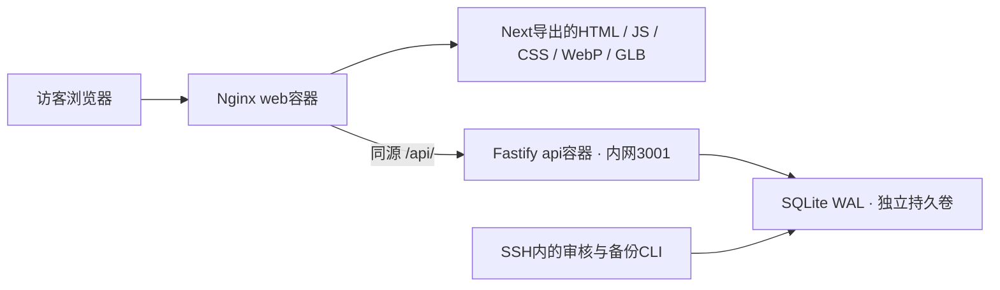

# SYYhSite 当前方案、素材缺口与下一版安全计划

更新：2026-10-14，北京时间。本文是当前事实整理和下一版工作范围，不是下一版已实施的报告。当前P2第一版已交付，P3–P5尚未启动；本轮只读检查、依赖审计和文档更新，没有修改线上配置、写入留言或生成正式素材。

## 1. 当前运行基线

- 公开预览：[首页](http://124.220.190.120/)、[四岛](http://124.220.190.120/hub/)、[About](http://124.220.190.120/about/)。
- [GitHub分支](https://github.com/smallyyh0721/SYYhSite/tree/codex/draft-v1)：`codex/draft-v1`。
- 云端应用运行SHA：`e18816aa8195d77c47b1c46c52e438d6050e373a`，2026-10-14通过SSH再次核对。后续文档/协作规则提交不改变这份运行版本。
- 两个容器：`syyh-draft-web-1`与`syyh-draft-api-1`，本轮检查均healthy。Web对外映射80；API的3001没有宿主端口映射。
- 服务器既有基线为Ubuntu 24.04、linux/amd64、2 vCPU、约3.6GiB内存。本轮未重新测量硬件；沿用轻量两容器架构。
- 上轮验证记录：typecheck、9项Node测试，本机/公网各10项新增交互+15项四岛回归。本轮没有重跑这些功能测试；新检查是公网响应头、当前容器配置和生产依赖审计。
- 当前仍为IP HTTP预览，正式域名与HTTPS未接入本项目。本轮未检查其他服务器服务或防火墙完整规则。

参见[P2交接](phases/P2/handoff.md)、[最终交互验收](reports/P2-09.md)、[部署事实](../agent-handoff/deployment-facts.json)。

## 2. 已经应用的设计与交互

| 区域 | 已应用行为 | 下一版保留的约束 |
|---|---|---|
| 欢迎页 | WELCOME TO MY WORLD.与CONNECT居中；不挂载人物；CONNECT按2.4秒周期呼吸闪烁，hover/键盘focus保持稳定 | 不新增昵称输入；减少动态时不闪烁 |
| 连接招呼 | CONNECT后HELLO STRANGER；人物不跟随鼠标；可SKIP，自动进入Hub；当前是待机代理/加载海报 | 下一版改一次性伸手视频；首次加载、播放失败和跳过都不能卡住入口 |
| 四岛世界 | 全屏2.5D透明岛，前/左/后/右菱形轨道；悬停260ms，1.35秒弧线切换；选中岛中央点亮，其余灰色 | 点击整个岛图进入；运动经过静止指针不抢焦点 |
| 手机 | 第一次点击选中居中，第二次点击同岛进入；运动未完成不进入 | 继续保留触摸、键盘与减少动态路径 |
| 作品 | 四岛分别进入天空与建筑、自然与地貌、科幻与末日、二次元与日常；独立主题列表和详情 | 目前内容是本站设计研究；正式个人作品待用户提供 |
| About | 真3D代理的头/眼/轻微上身跟随页面鼠标；失焦回正；触摸与减少动态不跟随；加载失败显示海报；纸页模式 | About与未来招呼视频使用同一正式人物身份 |
| 导航/主题 | 关于、故事、留言在顶部菜单；Day蓝白/Night暗黑贯穿全站，主题保存；返回恢复岛焦点/作品位置 | 保持真实URL、浏览器Back与刷新 |
| 背景 | Hub有整图慢移、渐变雾和星点；可暂停，后台/减少动态停止；欢迎和招呼目前使用静态环境 | 可感知的真实云动尚未完成，下一版补独立云层后改进 |
| 留言 | 提交pending、人工审核后公开；真实SQLite持久化；没有公网审核后台 | 不放虚构已审核留言，不把身份/内容空缺自动补成用户事实 |

完整3D岛屿仍为可选方向，当前采用2.5D；无需等完整岛模型才能升级素材。

## 3. 已采用的技术栈与部署

版本取自当前package/配置和本轮运行检查，不表示市场上的最新版本。

| 层 | 当前技术 | 作用 |
|---|---|---|
| 页面 | Next.js 16.4.0、React 19.3.0、TypeScript 7.0.2 | App Router、静态生成/导出；生产不运行Next Node服务器 |
| 样式/状态 | CSS Modules、CSS变量/tokens、React状态与Ref、localStorage/sessionStorage | 双主题、布局、动效参数、焦点/返回恢复；不在浏览器保存管理凭据 |
| 动画/3D | GSAP 3.15.0、Three.js 0.186.1、React Three Fiber 9.8.1 | 岛轨道/招呼时间线；About GLB骨骼、头眼阻尼跟随 |
| 留言服务 | Node.js 24、Fastify 5.12.5、内置node:sqlite/WAL | 小型独立JSON API、审核状态、幂等、持久化 |
| 生产Web | Nginx 1.30.5（本轮容器实测） | 静态文件、缓存、真实404、同源代理`/api/` |
| 构建/媒体 | pnpm 10.32.1、锁文件、Sharp 0.34.5；ChatGPT imagegen；本机Blender | 一致依赖、PNG→WebP、原创图片、模型/动作/渲染源 |
| 容器/验证 | Docker Compose、linux/amd64、多阶段Dockerfile、Node测试、Playwright/Edge | Windows本机Linux生产验证，再在Ubuntu运行；浏览器鼠标/模拟触摸与失败路径 |
| 协作 | Codex统筹/图片/Blender/独立验收/发布；Grok CLI完整模块实现与研究 | 按模块交付、评分趋势调整任务量、不可用时Codex接管 |

当前发布流程是：本机开发→Linux生产构建与测试→固定Git SHA/推送GitHub→云端拉同版本或接收校验过的Git bundle→Ubuntu按相同SHA/Dockerfile/lockfile构建→Compose健康检查→公网复核。两端分别构建；并非传送本机同一镜像。

基础镜像固定digest、安装使用frozen lockfile；镜像标记源码SHA，保留旧镜像和env。API以`node`用户运行，数据卷`syyh-draft-cloud-guestbook`独立于镜像；本机使用独立local卷。Compose已有128MiB/Web、256MiB/API内存上限、健康检查、重启策略与10MiB×3日志轮转。

下一版沿用这套结构。域名/TLS、CSP、限流、容器权限等在现有两容器上完善，不需要改变页面技术栈。

## 4. 素材现状与缺口

本机已有并已接入的运行素材：四张透明岛WebP约2.00MB；Day/Night两张环境WebP共287,222B；代理GLB 727,424B；代理poster 322,204B。源图、生成提示词与manifest保留。设计画廊/分镜是设计源，不等于完整动画或正式人物。

| 优先级 | 缺失项 | 下一版具体交付 | 负责 |
|---|---|---|---|
| 必须 | 正式人物身份与外观 | 用户确认人物方向；可重复打开的`.blend`、About用GLB、纹理/海报；保持头、脊柱、眼控制契约或同步适配 | 用户提供身份方向，Codex制作/验证 |
| 必须 | HELLO STRANGER伸手迎接视频 | 同一人物面向访客、伸手、短停；一次播放，不跟鼠标；横/竖、Day/Night、MP4/WebM候选与poster、Blender动作源 | Codex制作；Grok实现完整播放器 |
| 必须 | 可见动态的分层背景 | Day/Night×横/竖无岛底板；远/近透明云层；静态poster；背景不能重复烘焙岛 | Codex出图；Grok实现背景模块 |
| 必须 | 四岛正式光照与分层 | 四种风格保持轮廓，补日夜光照、选中/未选中层、精细透明边缘、近远层；保留点击热区和手机版安全区 | Codex出图/视觉验收，Grok接入 |
| 必须 | 用户真实内容 | 四类作品封面/详情/过程图、简介/兴趣/工具/时间线、故事正文/关键帧、联系方式/社交链接 | 用户提供事实，Grok整理展示，Codex核验 |
| 必须 | 分享与品牌素材 | favicon、社交分享图、最终LOGO资产；如选自托管品牌字体，带字体文件和许可证 | Codex生成，Grok查来源/许可 |
| 可选 | 音效、HDRI/纹理、循环背景视频 | 在明确用途与许可后加入；音效默认静音并由访客主动开启；分层静图效果不足再评估循环视频 | Grok查许可，Codex制作/验证 |
| 可选 | 完整3D岛模型 | 选定完整3D方向后制作GLB/LOD及运行验证；不是下一版素材升级的默认前提 | Codex/Blender |

人物方向、用户真实作品、正式域名是尚待输入；可先制作背景与代理动作预演。银发伸手分镜只作构图参考，不能直接认定为用户最终形象。

素材源保存在新版本目录，保留旧版；运行WebP/GLB/视频与源文件分开，每项有尺寸、字节、SHA256、用途、主题、许可/来源。外来SVG/脚本/模型附件先检查；未验证许可的候选不进public。模型压缩若引入解码器，要先完成加载/失败路径验证。

详细构图、时间和体积预算见[背景与视频素材方案](background-next-version.md)。预算不是已导出或已测试的实际结果。

## 5. 安全现状：已有保护与今天发现的缺口

### 已经存在

- API没有宿主公开端口；审核/备份走SSH内CLI，没有公网管理接口。
- Nginx请求体上限8KiB，Fastify上限4KiB；昵称/留言Unicode长度限制与控制字符检查；蜜罐字段。
- SQL使用参数化语句；公开GET只返回approved，限100条，`Cache-Control: no-store`。留言按React文本渲染，不把访客内容交给`dangerouslySetInnerHTML`。
- 默认每IP每10分钟5条有效新提交、待审核总量上限5000、内存桶数量上限10000；持久化幂等键及冲突处理。
- API非root、独立SQLite卷、在线一致性备份CLI；私钥/数据库/env排除Git及镜像，基础镜像digest和lockfile固定。
- Nginx源码配置了nosniff、Referrer-Policy和X-Frame-Options，但覆盖范围存在问题，见下表。

### 2026-10-14只读检查结论

| 发现 | 实际证据 | 下一版处理 |
|---|---|---|
| HTML/JS安全响应头缺失 | `/`、`/hub/`、`/about/`、一个`/_next/static/*.js`的nosniff、X-Frame-Options、Referrer-Policy均为空；API/图片/404保留 | 优先修复Nginx add_header继承；补覆盖200/404/429/413等实际响应的检查 |
| 当前未启用CSP | 检查的8个公开响应均无CSP/Report-Only | 为静态导出构建CSP策略并验证，随后强制执行 |
| 当前仍为HTTP | Web公开映射80，预览地址HTTP；本项目未配置TLS | 确认域名/DNS，接入TLS、续期、HTTP→HTTPS；证书稳定后配置HSTS |
| 容器权限尚未进一步收紧 | 两容器readOnly=false、CapDrop=null、SecurityOpt=null；Web未显式设置运行用户，API为node | 核对实际UID/文件写需求；只读根文件系统、最小可写卷/tmpfs、去能力与no-new-privileges |
| 限流不持久且覆盖有限 | API计数在内存，重启会重置；校验/幂等检查在有效提交限流之前 | 增加代理层请求速率/连接保护；API稳定限流与清理策略；合法幂等重试仍保持 |
| 依赖审计未报已知漏洞 | 本次`pnpm audit --prod --json`退出0，125个生产依赖，五级漏洞计数均0 | 继续做锁文件审计及镜像系统包扫描；不能由此推断整个网站不存在漏洞 |

响应头问题与Nginx默认继承规则一致：location自身设置`add_header Cache-Control`会使server级add_header不再自动继承。当前运行Nginx 1.30.5；可评估其支持的`add_header_inherit merge`，或统一include安全头片段。具体配置由下一版测试决定。[Nginx官方规则](https://nginx.org/en/docs/http/ngx_http_headers_module.html)

证据：[公开响应头](evidence/baseline-2026-10-14/public-headers.json)、[容器运行核对](evidence/baseline-2026-10-14/runtime-summary.txt)、[依赖审计](evidence/baseline-2026-10-14/dependency-audit.json)。检查脚本见同目录inspect-public.mjs。只执行少量公开GET、元数据检查与registry审计；没有提交攻击载荷、读取留言库、扫端口、做压测或修改服务器。

## 6. 下一版安全加固的实施范围

| 优先级/模块 | 做什么 | 完成标准 |
|---|---|---|
| 第一优先：响应头与TLS | 修复继承；统一nosniff、拒绝iframe、Referrer-Policy、Permissions-Policy；接域名/TLS及自动续期 | HTML/JS/图片/视频/API/错误响应均有预期头；证书/域名/重定向正确，媒体与API无混合内容 |
| 第一优先：CSP | Report-Only观察，再强制；脚本、模型fetch、图片、字体、视频限定本站；拒绝object、frame、意外外发和eval | 所有主题/详情/404、Day初始化、About GLB、GSAP、视频、留言均正常；非授权脚本/来源被阻断 |
| 第一优先：留言抗滥用 | 严格schema/类型与来源约束；补Origin/Sec-Fetch-Site策略、代理层请求限流/连接上限，API稳定限流；保持可信代理边界 | 无效/跨站请求、超量/大请求有明确拒绝；伪造XFF不改变可信IP；正常提交/幂等/审核隔离通过 |
| 第二优先：容器与主机 | 非root可行性、只读rootfs、tmpfs与/data最小写权限、cap_drop/no-new-privileges；核对SSH/云安全组/防火墙；仅必要端口 | API不公开、DB不可从Web访问；重启/健康/模型/视频/备份不受权限约束误伤；旧卷保留 |
| 第二优先：供应链 | pnpm审计、镜像OS包扫描、更新基础digest/必要依赖、源码/产物校验、构建记录 | 无未处置的可利用高危/严重告警；误报/构建期与运行期影响有证据记录 |
| 第二优先：数据与运营 | 定期一致性备份、异机备份与独立卷恢复演练；错误/资源/限流告警，日志脱敏/保留周期 | 能实际恢复approved/pending隔离与幂等；不覆盖生产库，不公开日志/备份，不收集无用个人资料 |

实施细节：

1. **CSP适配现有静态架构。** `app/layout.tsx`有固定主题初始化内联脚本，Next导出HTML还有框架启动脚本。优先构建时扫描并生成对应hash，保持HTML/策略同版本；不能套一个每次响应随机nonce的动态方案却仍发同一静态HTML。先用浏览器收集Report-Only违例，不必新增公网上报接口。GSAP/React需要动态style属性，单独验证style策略，不因其需求开放任意内联JavaScript。[OWASP CSP指南](https://cheatsheetseries.owasp.org/cheatsheets/Content_Security_Policy_Cheat_Sheet.html)
2. **来源限制补充限流。** 当前匿名留言无登录cookie，不能把传统登录CSRF当作已有认证系统；重点是公开写接口的跨站滥用和直接机器人请求。Origin/CORS不能阻止能伪造请求头的服务器机器人，需要与可信IP、请求限流、队列上限一起验收。若以后加CDN，只信任明确代理范围，不能接受任意XFF。
3. **限流保持轻量。** 先在Nginx限制无效/重复请求对API的开销；需要跨重启稳定额度时评估现有SQLite中的限流状态与定期清理，迁移/接口由Codex冻结。不默认增加独立缓存服务。是否引入验证码取决于真实滥用数据。
4. **HTTPS先具备域名/证书。** 来源白名单、续期路径、代理层次随所选域名确定；HSTS在有效HTTPS确认后启用。当前HTTP预览不能称作正式安全发布。[OWASP REST安全指南](https://cheatsheetseries.owasp.org/cheatsheets/REST_Security_Cheat_Sheet.html)
5. **容器权限按运行需求收紧。** Web的cache/pid/tmp、API的SQLite WAL写入都有实际目录要求；修改端口、非root或tmpfs后必须重新验证健康检查和备份。容器配置不替代宿主/云安全组检查。[Docker安全说明](https://docs.docker.com/engine/security/)
6. **保留本版的审核隔离。** 下一版继续SSH管理；若另行要求公网管理后台，再定义管理员认证、权限和CSRF。正式内容进入只允许经过审查的数据，禁止执行素材附带的任意脚本。

## 7. 下一版建议执行顺序与分工

| 顺序 | 可验收交付 | 负责人/阶段关系 |
|---|---|---|
| 1 | 冻结人物、真实内容范围、域名与下一版资产清单；明确安全基线和验收矩阵 | Codex统筹；P3输入准备，域名可独立确认 |
| 2 | 背景/岛图/人物/动作/品牌素材源与运行资产、manifest、预算/许可 | Codex图片与Blender，Grok资料/许可；P3素材完成 |
| 3 | 完整分层背景模块；完整一次性招呼播放器；真实作品/故事展示 | Grok按完整模块交付并自检，Codex独立验收；素材就绪后进入P4集成 |
| 4 | 留言抗滥用模块与安全验证脚本；CSP/TLS/Nginx/容器/备份配置 | Grok实现明确接口内API模块和自检；Codex维护共享契约/锁文件/迁移、部署配置及独立安全验收；可与素材准备并行推进工程检查 |
| 5 | 固定候选SHA，本机Linux生产验收，部署云端，公网复核/备份恢复与回滚准备 | Codex统筹发布；P4安全与素材共同作为正式发布条件 |

下一版不是把新图片换上后直接发布。验收同时覆盖：3–5秒能辨认云的相对运动；伸手视频一次播放/skip/失败/超时；About跟随与降级；手机两次点按；CSP下主题/3D/视频/留言；公开安全响应头；输入/来源/超量/幂等/审核隔离；容器重启、数据备份恢复与资源预算。

每个Grok任务采用当前[完整模块委派规则](grok-collaboration-rules.md)，任务书先写文件归属、接口、预算、失败/成功路径和证据目录；Codex验收评分。当前样本不足，保持每批最多2个完整模块、默认1个CLI；Grok不能响应或继续时Codex接管。本文没有启动Grok任务，也没有变更任务队列/阶段状态。

待后续实际执行后，把完成素材和安全证据更新到asset-manifest、deployment-facts、对应阶段任务/报告及完整交接包；保留当前应用SHA与数据卷作为更新基线。
