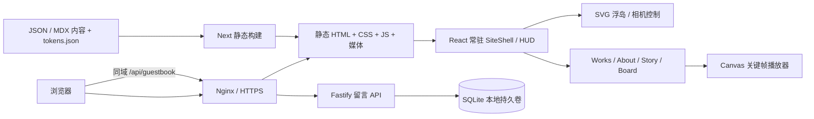

# SYYH Signal · 代码实施方案 v1

状态：方案，尚未创建生产工程、安装网站依赖或部署。只在设计审核通过后实施。范围是现有 README 的 Gate、Hub、四频道、作品详情、公开留言及辅助导航。默认个人内容通过文件维护，不增加用户账户和大型 CMS。

## 推荐架构

**Next.js App Router + React + TypeScript + CSS Tokens + SVG/Canvas + GSAP**。公开页面构建时生成静态 HTML，客户端负责探索世界和转场。留言单独由 **Node.js LTS + Fastify + SQLite** 服务处理。同域 Nginx 静态托管并反向代理 `/api/`；部署位置待实际环境确定。静态页面也可放 CDN，数据库服务仍需可持久化的运行环境。



选择静态生成是为了直达作品、分享预览和搜索收录，同时保留 React 客户端转场。[Next 静态导出](https://nextjs.org/docs/app/guides/static-exports)生成每个路由的 HTML；它不提供动态 POST API、Server Actions 或默认图像优化服务。因此留言放独立服务，图片构建时预处理，不能把这两项错误塞进静态导出。

## 技术选型与边界

| 项 | 推荐 | 目的 / 边界 |
|---|---|---|
| Web | Next.js 稳定版 App Router，`output: 'export'` | 编译时生成内容路由。版本在实施当日核对并锁定，不使用浮动 latest |
| UI | React + TypeScript | 现有 React 草稿可迁移设计理念；正式工程不用 CDN UMD 与 window.SYYH 全局包 |
| 样式 | CSS Modules + 现有 CSS 变量 / token 生成器 | 继续一处管理品牌，不为本项目增加第二套视觉主题体系 |
| 世界 | SVG 岛屿/路线 + DOM HUD + RAF 相机 | 2.5D 线稿已经足够，Three.js 暂非必需；若审核要求真 3D 再评估 |
| 动效 | GSAP timeline + ScrollTrigger，按需加载 | 入口、揭幕和 Story；相机 RAF 不与 GSAP 同时写同一个 transform |
| Story | Canvas 2D、ImageBitmap、有界帧缓存 | 只在 Story 加载；减少动态及失败时展示正文关键帧 |
| 内容 | 类型校验的 JSON + MDX | 作品、个人资料、链接、故事分镜；不执行外来 MDX |
| 图像 | 构建前 Sharp 生成 AVIF/WebP/JPEG 尺寸组 | 静态导出下用 picture/srcset；保留宽高，避免跳动 |
| API | Fastify + TypeScript + schema 校验 | 仅留言列表、提交和维护工具；公开表单没有管理权限 |
| 数据 | SQLite，本地盘，单实例 | 个人留言量适用；多机写入再迁移 PostgreSQL |
| 交付 | pnpm lock、Docker Compose、Nginx | 可重复构建；不将浏览器原型 server 作为生产服务 |
| 验证 | Vitest（算法/API）+ Playwright（关键流程） | 优先测试旅行语义、历史返回、留言与真实触摸行为 |

[ScrollTrigger 官方文档](https://gsap.com/docs/v3/Plugins/ScrollTrigger/)支持 pin、scrub 和滚动回调；采用原生滚动，不照搬参考的第二套滚动器。[Fastify](https://fastify.dev/docs/latest/)提供路由、类型及请求校验结构。[SQLite WAL](https://www.sqlite.org/wal.html)要求共享数据库的进程同机运行，不放在网络文件系统；实施时核对所选 SQLite 版本与修复公告。

Astro 可用于以文章为主的站点，但本项目要求常驻 HUD、世界状态和跨页转场，React/Next 的统一壳更直接；Vite + React 也可实现，不过需要额外安排逐路由预渲染。当前不需要微服务拆分、Redis或全局 Redux。

## 工程结构（拟建，当前不存在）

```text
SYYhSite/
  app/
    layout.tsx                 # 站点壳、元信息、主题
    page.tsx                   # Gate
    hub/page.tsx
    works/page.tsx
    works/[slug]/page.tsx       # generateStaticParams
    about/page.tsx
    story/page.tsx
    board/page.tsx
    not-found.tsx
  src/
    components/ui/             # Button、Frame、Hud、标题
    features/gate/              # Intro、CallsSign
    features/world/             # WorldMap、Island、Camera、Navigation
    features/works/             # Gallery、WorkDetail
    features/story/             # SequencePlayer、FrameCache、Captions
    features/board/             # GuestbookForm、List、API client
    state/site-context.tsx      # 会话、主题、上次相机与转场
    content/                    # works、profile、links、story manifest
    lib/                        # schema、media、motion preference
  design/                       # 原有 tokens 与审核材料保留
  public/media/                 # 用户自己的优化媒体
  services/guestbook/
    src/routes/ src/db/ src/admin/
    migrations/
  deploy/                       # compose、nginx、备份脚本
  tests/                        # 关键算法与浏览器流程
```

## 路由与状态

| URL | 首次进入 | 返回 |
|---|---|---|
| `/` | Gate；入口按会话播放一次 | 可重新体验 |
| `/hub/` | 默认或会话保存的相机 | 世界菜单可回到此处 |
| `/works/` | 作品大图与列表 | 返回 Hub 恢复 CH-01 位置 |
| `/works/neon-alley/` 等 | 直接访问作品详情，短到达过渡 | 返回列表，恢复滚动和焦点 |
| `/about/` | 自述和资料，可 Paper | 恢复 CH-02 |
| `/story/` | 第一章或当前会话阅读位置 | 恢复 CH-03 |
| `/board/` | 联系信息和真实留言 | 恢复 CH-04 |

URL 是当前内容页面的真相，禁止只用内部 `screen` 状态替代 URL。常驻 layout 保存 HUD 与 camera。按标准浏览器 History 回退；无 JS 时所有频道和作品链接仍能打开静态页。直接深链不强迫重新填昵称，也不先跳 Gate。用于搜索引擎的导航与辅助菜单必须是语义化链接。

Context 仅保存低频状态：`callsign`、`theme`、`soundEnabled`、`lastIslandId`、`cameraSnapshot`、`transitionPhase`。坐标和逐帧数据存在 ref/控制器，避免每帧 React setState。只存会话昵称，不存身份令牌；主题及声音偏好可本地保存。

## 相机与转场实现约定

1. PointerInput 把地图区域指针坐标归一化到目标相机；WheelInput、TouchDrag、KeyboardInput 写同一个目标，不重复注册四套动画循环。
2. 统一 RAF 用 timestamp 算 `dt`，阻尼 `alpha = 1 - (1 - 0.075)^(dt / 16.667)`。恢复可见时重置上一帧时间并限制 dt，避免瞬移。[MDN](https://developer.mozilla.org/en-US/docs/Web/API/Window/requestAnimationFrame)明确提示按时间推进，以免高刷新率改变速度。
3. 保留草稿的吸附半径与聚焦半径作为初值，按 world units 管理；进出聚焦用不同阈值。指针落在 HUD、菜单和进入按钮时冻结相机目标；拖拽与点击区分移动阈值。
4. EnterFocusedIsland 检查 focused id，只接受已抵达岛。旅行期间的点击不 aimAt。辅助频道列表与键盘选择有单独语义。
5. 进入时锁输入 → 650ms transition → router.push → 内容标题焦点；失败/卸载清理锁。内容预取失败仍用语义链接导航，不能卡在遮罩中。
6. 返回前读相机快照，先恢复再淡入世界；缩放或旋转屏幕重新 clamp。RAF、事件监听、ResizeObserver、GSAP context 在卸载、页面隐藏及偏好改变时清理。

## Story 素材与内存预算

设计以三段故事组织：SIGNAL、ASCENT、ARRIVAL。待审核后确定原创浮城镜头，先做 3–6 张关键帧阅读版，再根据用户素材完成序列帧；不能从参考网站复制角色或 300 张素材。

桌面序列候选 120–180 帧、最大约 1280×720；手机 60–90 帧、约 640×360。**这些是待素材验证的目标，不是已有性能数据。** 720p 解码图约 3.5MB/张，不能一次缓存完整序列。桌面最多约 16 个已解码帧（约 56MB），手机约 12 个 360p 帧（约 11MB）；只预取当前附近和下一章关键帧，并关闭淘汰的 ImageBitmap。并发解码 2–4，网络帧也有上限。

帧名采用无前导空行的 manifest 数组；frame index 从 0 开始，限制边界。加载失败保留上一张成功帧并显示可读字幕，不调用未准备好的 drawImage。Canvas 的分辨率和 DPR 分别设上限；在旋屏时重新调整，保留进度。没有素材、Save-Data 或减少动态时直接采用关键帧正文。

## 留言服务与数据契约

`GET /api/guestbook?cursor=...&limit=20` 仅返回 approved 留言，分页不无限加载。

`POST /api/guestbook` 收 `{callsign, message, submissionId}`，昵称 1–24 字、消息 1–140 字（按 Unicode 字符处理）；游客自动签为 GUEST。返回 202 与待审核状态。submissionId 唯一，重试不重复插入。429 给重试时间；5xx 保留表单。

表：`guestbook(id, submission_id UNIQUE, callsign, message, status, created_at, reviewed_at)`，状态 pending/approved/rejected；以 created_at/id 作游标索引。服务端验证长度、只接受纯文本、参数化 SQL、限流与 honeypot；前端不能携带管理员密钥。管理先用服务器端 CLI 审核，不增加未设计的公众管理入口。数据库持久卷、在线备份及恢复演练是上线条件。SQLite WAL 的备份不能只随意复制运行中的 .db 文件。

## 部署、预算与验收

建议 Nginx 从 `out/` 提供静态页面，`trailingSlash:true`，未知文件返回 404；`/api/` 代理本机 Fastify。媒体按哈希长缓存，HTML 短缓存；配置 HTTPS、压缩和合适响应头。Docker 容器重启后数据库不丢失；数据库不在 Git。若最终选纯静态托管，留言 API 必须另行运行，不能假装跨访客共享 localStorage。

目标：内容页移动端 LCP ≤2.5s、INP ≤200ms、CLS ≤0.1；目标设备上 Hub 接近 60fps，低端设备有轻量模式。首屏不下载 Story 全序列，主 KV 控制约 250KB 内；性能预算在真实媒体录入后通过浏览器与慢网测量验收。

关键测试：刷新作品深链、后退恢复焦点/相机、上下左右旅行、未聚焦点击不会移动、触摸拖动不误入、纸色可读、320/390/768/1440 布局、减少动态即时切换、媒体失败、留言验证/限流/幂等/审核隔离及重启持久化。测试算法与关键行为，不为每个纯样式组件堆测试。

## 审核通过后的实施顺序

1. 冻结已审视觉与交互，录入真实个人信息和第一批素材；完成参考浏览器复核遗留项。
2. 建立类型化工程，迁移 tokens 和 UI，完成静态内容与 deep links。
3. 实现 Gate、世界相机、辅助导航、转场与手机交互，验证旅行语义。
4. 完成作品详情、About、Board 及留言服务，替换所有示例链接。
5. 完成 Story 关键帧和用户确认的完整素材版本；做性能与可访问性验收。
6. 提供可运行本地预览、构建结果与部署配置。发布地点及域名以用户实际环境为准；设计通过不自动等同于公开部署授权。

本轮只完成上述设计和实施文档，不执行此清单。
