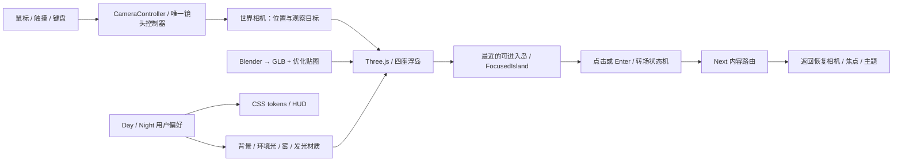

# SYYH Signal · 3D 与主题实施方案 v2

状态：待设计审核。用户已澄清：明确要求 3D 的对象是 **VISITOR ACCESS 右侧人物**，具体形象后续设计。入口人物跟随见 [visitor-avatar-plan.md](visitor-avatar-plan.md)，以该说明为准。下文的四岛 3D 世界是可选实施方案，不自动覆盖 v1 的 SVG/2.5D 方案。Next.js、React、TypeScript、内容路由和独立留言服务继续沿用。这里的代码和坐标为说明示例，不是已实施工程。

## 可选方案：四岛真正 3D 世界

四座不同风格浮岛需要从远到近飞行、看到不同侧面、产生遮挡和统一日夜光照。推荐 **Three.js + React Three Fiber（R3F）+ Drei + GLB/glTF 模型**，集成到 Next 的客户端 Canvas 中。模型由 Blender 或相应 DCC 制作；本轮概念图只作为建模参考，不会自动变成准确的 3D 模型。

v1 的“SVG/PNG 多层平移 + 缩放”能产生 2.5D 视差，成本较低，但侧面和背面始终不存在。四个有建筑/地貌的场景若要自由观察，应采用真正 3D；手机或 WebGL 不可用时保留 2.5D 图片降级。



## 1. 若选择 3D 浮岛：世界动画和鼠标镜头旅行

3D Canvas 内有四座固定位置的岛、一个 camera，以及少量云/粒子；网页 HUD 和内容文字仍是普通 DOM，以保持清晰可读和可访问。

**岛屿的自身动画**：整体上下小幅漂浮，塔顶信号缓慢变化，碎片绕固定中心低速运动。简单运动在 R3F `useFrame` 中更新；模型自带的风车/门等动画使用 glTF clip + AnimationMixer。每帧修改对象 ref，不每帧重渲染 React。

**鼠标控制镜头**：读取指针在地图 Canvas 中的相对位置，归一化为 `u,v ∈ [-1,1]`，映射到世界平面目标。屏幕向右意味着向世界右侧旅行，屏幕向上向上方岛移动。显示的相机位置是观察目标加一个固定斜上方偏移，因此保持清楚的三分之四角度。

```text
u = 2 × pointerX / canvasWidth - 1
v = 1 - 2 × pointerY / canvasHeight
targetFocus = mapToBoundedWorld(u, v)
targetFocus = applySoftIslandAttraction(targetFocus)
targetCamera = targetFocus + viewOffset
alpha = 1 - exp(-damping × dt)
camera.position = lerp(camera.position, targetCamera, alpha)
lookTarget = lerp(lookTarget, targetFocus, alpha)
camera.lookAt(lookTarget)
```

这不是把鼠标坐标直接赋给模型旋转。镜头有边界和阻尼，不会无限飞出世界，也不会随指针小抖动剧烈晃动。`damping≈4.7/s` 可近似 v1 的 60Hz 下 0.075 初始手感；参数需真实设备调试。相机的移动与岛屿漂浮分别由控制器处理。

Hub 总览可以使用较小 pointer parallax；正式旅行使用较大地图范围。两者是世界状态机内的不同模式，不把 OrbitControls 的自由旋转与鼠标旅行同时启用。接近岛时选择预设 docking view，避免穿过楼体；Raycaster 用简化碰撞体检测指针命中，不能把“悬停”直接当成“到达”。入口人物使用固定镜头与骨骼跟随，不复用这套世界镜头逻辑。

R3F 的 [基础动画文档](https://r3f.docs.pmnd.rs/tutorials/basic-animations)说明 `useFrame` 与 delta；[Three.js Raycaster](https://threejs.org/docs/pages/Raycaster.html)用于对象命中检测。

## 2. 岛屿跳转如何实现

区分两件事：**世界内旅行**移动相机；**进入岛屿内容**切换 URL。默认旅行仍由鼠标/滚轮/拖动完成，不使用点击远岛来偷偷移动相机。

```text
EXPLORING
  → 用户移动相机，进入岛的 docking 范围
FOCUSED
  → 出现频道名和“进入”；普通点击只对 focused 岛有效
ENTERING
  → 锁定旅行输入，保存当前视角，沿预设轨迹接近入口
CONTENT
  → 加载内容路由，淡出 3D Canvas，焦点移到标题
RETURNING
  → 恢复原相机与 focused 岛，淡入世界，解锁旅行
```

所有岛有配置：`id`、worldPosition、模型 URL、dockingCamera、lookAt、entryCurve、contentRoute。示例世界位置可用 `(-12,0,-8)`、`(12,0,-8)`、`(-12,0,10)`、`(12,0,10)`，实际布局按模型包围盒和可视范围校准；不能直接照搬二维 SVG 的 340px 半径到 3D。

“到达”按 camera 的观察目标与岛的 docking zone 距离判断，加进入/离开两级阈值和短暂稳定条件，以免聚焦反复跳动。点击时再验证 focusedId、输入锁、模型已就绪及拖拽距离阈值。辅助频道列表明确作为直接导航入口，不受默认旅行语义限制。

进入轨迹用 GSAP 驱动统一 CameraController 的 `transitionProgress`，或沿 CatmullRomCurve3 求镜头位置。一次只有 CameraController 写 camera，不能 useFrame 和 GSAP 各自抢写 position。路线避开建筑、底座和其他岛，进入到约 0.65–1.0 秒，再 router.push 到 `/works/` 等内容。过渡失败则用正常链接打开，解除输入锁，不能永远停在加载遮罩。

跨岛旅行可随鼠标目标逐步经过世界；有意的岛间交通按钮若后续增加，也通过同一控制器沿路线飞行。此轮不增加未经确认的传送功能。深链 `/works/[slug]/` 仍直接进入内容，无需先游历四岛。

返回 Hub 使用 session 中的 cameraSnapshot 和 focusedId，而非重新播放开场。支持浏览器 Back/Forward、重载和直接链接；模型未就绪时先显示静态海报与 DOM 导航。路径需遵守 v1 静态导出约束。

## 3. Day / Night 如何实现

ThemeProvider 管理唯一 `day | night` 值，保存 localStorage；最早的安全初始化读取保存值，让首次绘制的 CSS 与偏好相符，减少闪烁。没有值默认 Night。DOM 使用 `data-theme` 与生成后的 CSS token，所有内容页共用同一主题。

3D 使用两套环境 preset：background、fog、ambient/hemisphere light、key light、emissiveStrength、曝光与星云可见度。切换通常只插值参数和材质状态，不下载另一套完整岛模型，不重建 Canvas；若确需不同环境贴图，仅缓存两个小型环境资源。白天/夜晚模型共享几何和材质纹理，窗光等独立 emissive mask 控制。

概念图的 Day/Night 是视觉目标，实际灯光需根据浏览器 tone mapping 和材质调试；不能把同一张图片调暗当作真实重打光。末日裂隙和宅岛灯光保留造型标识，但不会让 Day 背景变成夜色。减少动态模式关闭颜色动画，直接切换。

## 4. 资产制作和性能

1. 四岛概念通过后，先建低模白盒，验证位置、镜头、安全入口和手机轮廓；白盒阶段不要花大量成本精雕背面小物。
2. 分层建模：岛底、主要建筑、植被、小物、发光区域和少量动画部件。导出 GLB，检测尺度、原点、法线、材质和动画名。
3. 合并静态小物，重复窗户/树/书架使用实例化；使用纹理压缩和合理 atlas，按模型目标设备检测加载器兼容性。标签仍用 DOM，而不是烘焙小字到贴图。
4. Canvas 按路由懒加载，Next 客户端边界内使用 WebGL；不要在 SSR/静态构建访问 window、document 或 GPU。首次只优先加载当前最近岛低细节版本，其他岛按需加载并预留 poster。
5. 初始预算（待测）：四岛可见时约 150k–250k triangles、100 draw calls 内；单岛压缩模型约 1–3MB，贴图显存另算；DPR 桌面上限 1.5、手机上限 1–1.25。不能把传输文件大小当成显存占用。
6. 远景 LOD、减少透明层和动态阴影；低端设备关闭重后处理与实时多阴影。模型精细度服从 30/60fps 验收，不能承诺桌面画质在所有手机满帧。
7. 页面隐藏或进入内容页暂停绘制。若保持 scene 缓存只保留一个 Canvas/renderer；内存压力或 WebGL context lost 时释放资源并显示静态导航。用户随时可选轻量模式。

[R3F 性能文档](https://r3f.docs.pmnd.rs/advanced/scaling-performance)讨论实例化、LOD、资源复用和按需绘制；浮动动画开启期间需连续绘制，停用动画时才适合 demand 模式。

## 5. 实施新增模块

```text
features/world3d/
  WorldCanvas            # 唯一 R3F Canvas，客户端加载
  IslandAsset            # 模型加载/LOD/降级
  CameraController       # 鼠标旅行、停靠、进入/返回
  InteractionState       # exploring/focused/entering/content/returning
  ThemeEnvironment       # 与 DOM 同步的 Day/Night 光照
  IslandLabels           # DOM 标签与辅助导航
  AssetCache             # 预算、加载和释放
  island-config          # 四岛造型、坐标、入口、内容路由
```

## 验收增量

- Day/Night 点击后 DOM 与世界一致，刷新保留，用户选择不被系统覆盖。
- 四岛能从轮廓区分；Day/Night 使用同一模型，无形状跳变。
- 鼠标上下左右旅行、悬停按钮镜头暂停、未抵达岛不能误进入。
- 镜头避开楼体和岛底；进入/返回/Back 只由一个控制器负责。
- 手机拖动与点击区分，旋屏后重新约束相机，DOM 导航始终可用。
- 低端设备/WebGL 不可用/模型失败时可用静态导航继续看作品。

设计通过后再建模型与网站。当前生成的是四座浮岛的 Day/Night 概念设计图，尚未提供可旋转模型或已经运行的 3D 交互。
